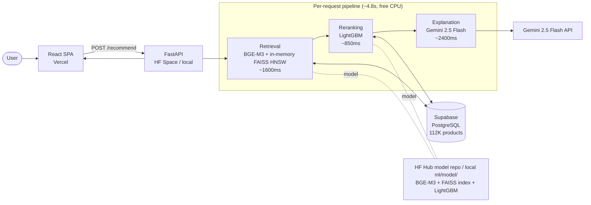
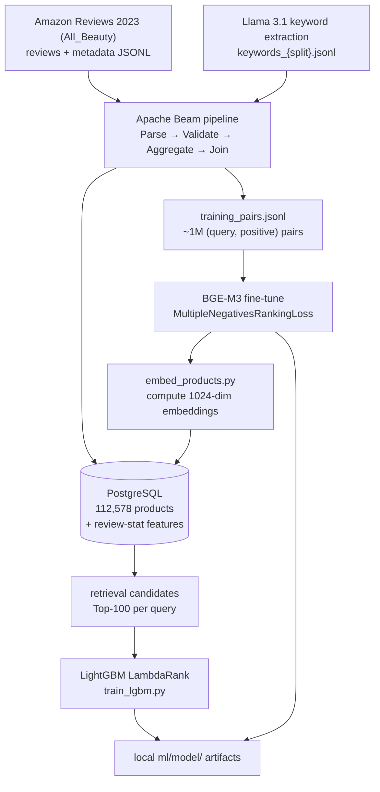

# Architecture

System architecture for ChatBeauty — an LLM & RAG based Amazon beauty-product
recommender. A user describes their situation in natural language; the system returns
Top-5 products with a data-grounded explanation for each.

For per-layer detail see [backend-architecture.md](backend-architecture.md),
[frontend-architecture.md](frontend-architecture.md), [ml-pipeline.md](ml-pipeline.md),
[db-schema.md](db-schema.md), and [deployment.md](deployment.md).

## High-level

The runtime path is a two-stage retrieve-then-rerank recommender followed by an LLM
explanation step:

1. **Retrieval** — encode the user scenario with the fine-tuned BGE-M3 (1024-dim), search an
   **in-memory FAISS HNSW** index (cosine) for the Top-100 candidates, then fetch their metadata
   from Postgres. No pgvector index is used at serve time — it doesn't fit the Supabase free cap.
2. **Reranking** — score the 100 candidates with a LightGBM LambdaRank model over 10
   metadata features and keep the Top-5.
3. **Explanation** — Gemini 2.5 Flash writes a short, review-grounded reason for all 5
   products in a **single** API call.

There is **no authentication**: `/recommend` is a single public endpoint (see
[Known limitations](#known-limitations--future-work)).

## Offline data & ML pipeline

The pipeline is offline (Apache Beam DirectRunner) and produces two things: the populated
`products` table and the BGE-M3 fine-tuning pairs. Embeddings are computed separately by
`ml/scripts/embed_products.py` (or the Colab notebook) and written back to the same table;
the serving FAISS HNSW index is then built from those embeddings and uploaded to the HF Hub
model repo (see [deploy/hf-space/DEPLOY.md](../deploy/hf-space/DEPLOY.md), Phase B). Details: [ml-pipeline.md](ml-pipeline.md).

## Components

| Layer | Tech | Where | Doc |
|---|---|---|---|
| Frontend | React 19 + TypeScript + Vite (SPA) | `frontend/` | [frontend-architecture.md](frontend-architecture.md) |
| Backend API | FastAPI + Uvicorn | `backend/app/` | [backend-architecture.md](backend-architecture.md) |
| Database | PostgreSQL 16 + pgvector (`halfvec` column; search runs in FAISS) | `backend/sql/` | [db-schema.md](db-schema.md) |
| ML | BGE-M3 (fine-tuned), LightGBM, Apache Beam | `ml/` | [ml-pipeline.md](ml-pipeline.md) |
| Deploy | Free-tier: Supabase (DB) + HF Space (backend) + HF Hub (models) + Vercel (paid GCP retired 2026-06-02) | `deploy/`, `backend/Dockerfile` | [deployment.md](deployment.md) |

## Latency budget

| Stage | Typical | Notes |
|---|---|---|
| Retrieval (in-memory FAISS HNSW) | ~1,600ms | dominated by BGE-M3 query encoding; + one metadata DB query |
| Reranking (LightGBM) | ~850ms | mostly the batched DB feature lookup; predict itself is fast |
| Explanation (Gemini 2.5 Flash) | ~2,400ms | all 5 explanations in one call, thinking disabled |
| **Total** | **~4,800ms** | free-tier HF Space CPU; logged per request via `LatencyMiddleware` |

## Known limitations & future work

These are the current, deliberate constraints of the system. Detailed docs link here
rather than restating them.

- **No authentication / rate limiting.** `/recommend` is a single public, unauthenticated
  endpoint. On any public (free) host this is exposed to abuse; API rate limiting is future work.
- **Thin test coverage.** `backend/tests/test_recommend.py` is an offline integration test
  for `POST /recommend` (services stubbed in `conftest.py`) and runs in GitHub Actions CI on
  every PR. There are no frontend or ML tests, and no test exercises the real models/DB.
- **No DB migration tool.** Schema is applied by running `backend/sql/init.sql` directly;
  there is no Alembic/migration history. Adopting a migration tool is a future option
  (see [db-schema.md](db-schema.md)).
- **MLOps maturity.** Model versioning is by local-path convention (e.g. the timestamped
  `ml/model/retrieval/bge-m3-finetuned-20260202-120852/` directory); there is no experiment tracking
  (MLflow/W&B) or production model/data-drift monitoring yet — both are future work.
- **`top_k` is fixed at 5.** The API request has no `top_k` field and the route hardcodes
  Top-5; clients that send `top_k` are ignored (see [api-spec.md](api-spec.md)).
- **Query encoding dominates retrieval** (~1.6s on free CPU). The vector index is an
  in-memory FAISS HNSW (`ANN_EF_SEARCH`, default 100); ONNX/int8 query encoding is future work.
