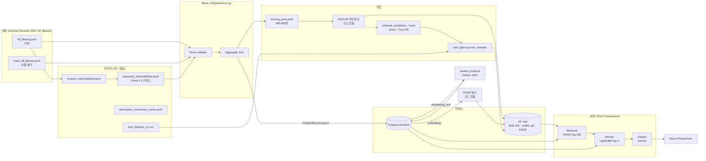
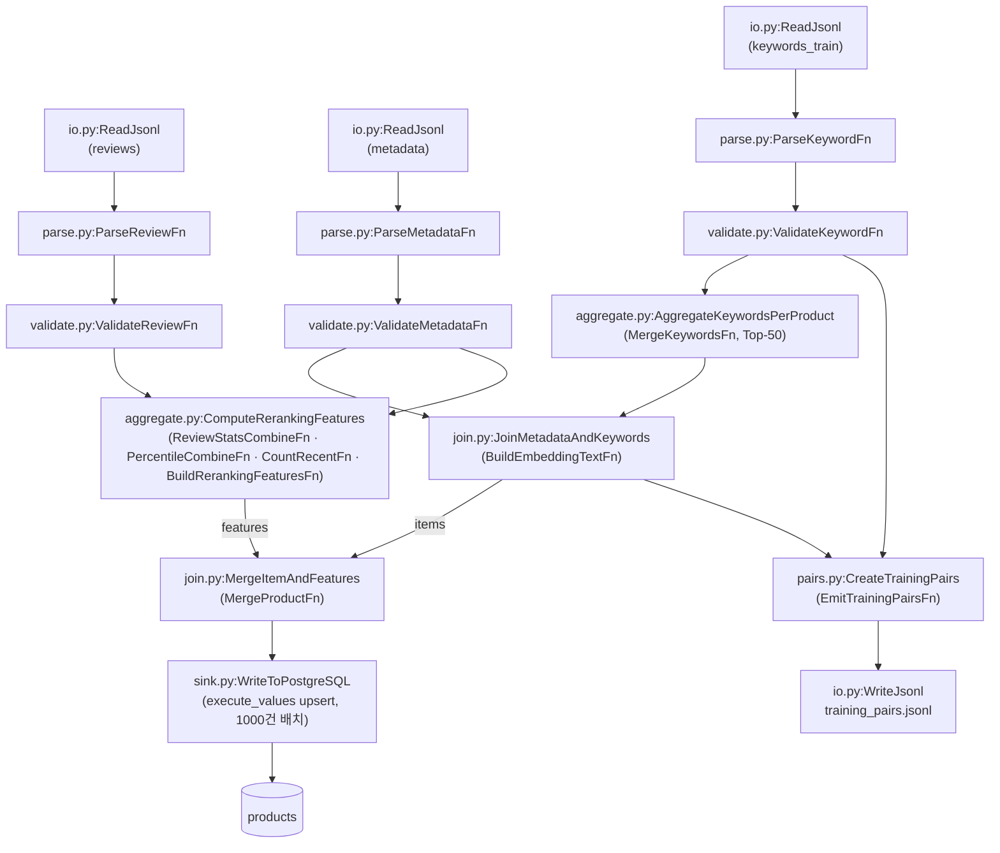
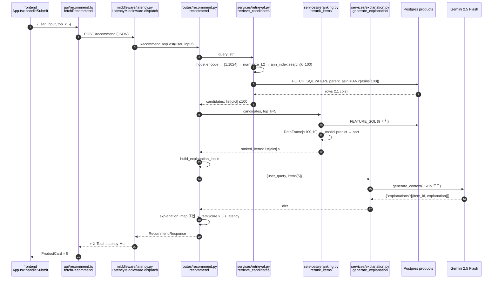
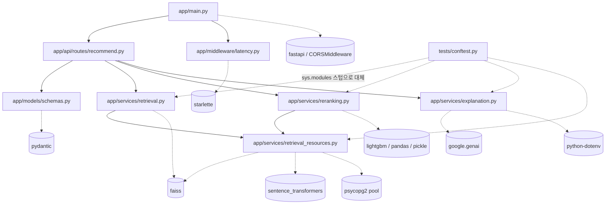
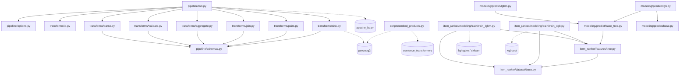

# 02. 데이터 흐름 추적 (원본 → 추천 결과)

> 기준: `main` @ `e7cb606` (2026-10-12). 코드는 수정하지 않았습니다.
> 입출력 형태는 코드, 로컬 `ml/data/` 파일의 첫 레코드, 모델 디렉토리 설정 파일(`modules.json` 등)로 확인했습니다.
> 레포에 코드가 없어서 산출물만 보고 추정한 단계는 **(코드 없음)** 으로 표시했습니다.
> 표기는 `파일:함수/클래스` 이고, 경로는 레포 루트 기준입니다.

## 0. 전체 그림



---

## Part A. 오프라인(학습·인덱싱) 파이프라인

### A-0. 원본 데이터 스키마 (로컬 파일 첫 레코드 기준)

| 파일 | 크기 | 주요 필드 |
|---|---|---|
| `ml/data/raw/All_Beauty.jsonl` | 327 MB | `rating: float`, `title: str`, `text: str`, `images: list`, `asin`, `parent_asin`, `user_id`, `timestamp: int(ms)`, `helpful_vote: int`, `verified_purchase: bool` |
| `ml/data/raw/meta_All_Beauty.jsonl` | 213 MB | `main_category`, `title`, `average_rating: float`, `rating_number: int`, `features: list[str]`, `description: list[str]`, `price: float\|null`, `images: list[{thumb,large,variant,hi_res}]`, `videos`, `store`, `categories: list[str]`, `details: dict`, `parent_asin`, `bought_together` |

### A-1. 전처리 (코드 없음)

레포 밖에서 만든 파일들입니다. 산출물만 있습니다.

| 산출물 | 형태 | 비고 |
|---|---|---|
| `processed/reviews_{train,valid,test}.jsonl` | 원본 리뷰와 같은 스키마 | 리뷰를 split으로 나눈 것 |
| `processed/keywords_{train,valid,test}.jsonl` (train 223 MB) | `{asin, parent_asin, title, review_text, rating, keywords: list[str]}` | Llama 3.1 8B로 리뷰마다 키워드 추출 (README 기준 WHO/WHEN/WHY) |
| `processed/description_summaries_cache.jsonl` | `{asin, summary: list[str]}` | Llama 3.1로 만든 설명 요약 |
| `processed/items_for_embedding.jsonl` (154 MB) | `{asin, title, review_keywords, description_summary, features, embedding_text, price, average_rating, store, categories, main_category}` | Beam 이전에 쓰던 아이템 텍스트. `join.py` 주석에 "이 포맷과 정확히 같아야 함"이라고 되어 있음 |
| `cleaned/item_v1/item_features_v1.csv` | 컬럼 `parent_asin, review_cnt, vp_review_cnt, vp_ratio, recent_review_cnt, avg_rating, rating_std, avg_review_len, log_median_price, price_cnt` | 리랭커 **학습**용 아이템 피처 (`TreeFeatureBuilder`가 읽음) |

### A-2. Beam 파이프라인 — `ml/pipeline/run.py:run`

옵션은 `ml/pipeline/options.py:ChatBeautyPipelineOptions`에 있고, 러너는 DirectRunner입니다.
레코드 타입은 모두 `ml/pipeline/schemas.py`의 NamedTuple입니다.



| # | 단계 (`파일:클래스`) | 입력 | 출력 | 핵심 로직 |
|---|---|---|---|---|
| 1 | `transforms/io.py:ReadJsonl` | JSONL 경로 | `PCollection[dict]` | `ReadFromText` → `json.loads` |
| 2a | `transforms/parse.py:ParseReviewFn` | `dict` | `Review(asin, parent_asin, title, text, rating: float, timestamp: int, helpful_vote: int, verified_purchase: bool)` | `parent_asin`이 없으면 `asin`으로 대체 |
| 2b | `transforms/parse.py:ParseMetadataFn` | `dict` | `Metadata(parent_asin, title, average_rating, rating_number, features: list, description: list, price: float\|None, store, categories, main_category, image: str, details: str)` | `images`에서 `variant=="MAIN"`인 `large` URL만 남김, `details` dict → JSON 문자열 |
| 2c | `transforms/parse.py:ParseKeywordFn` | `dict` | `KeywordRecord(asin, parent_asin, title, review_text, rating, keywords: list[str])` | |
| 3a | `transforms/validate.py:ValidateReviewFn` | `Review` | `Review` (필터링) | `parent_asin`이 비었거나 `len(text) < 10`이면 제거 |
| 3b | `transforms/validate.py:ValidateMetadataFn` | `Metadata` | `Metadata` | `parent_asin`이나 `title`이 비었으면 제거 |
| 3c | `transforms/validate.py:ValidateKeywordFn` | `KeywordRecord` | `KeywordRecord` | 키워드가 비었으면 제거 |
| 4 | `transforms/aggregate.py:AggregateKeywordsPerProduct` (+`MergeKeywordsFn`) | `KeywordRecord` | `(parent_asin, AggregatedKeywords(parent_asin, review_keywords: list[str] ≤50))` | 상품별 Counter → 빈도 상위 50개 |
| 5 | `transforms/join.py:JoinMetadataAndKeywords` (+`BuildEmbeddingTextFn`) | `(agg_kw, metadata)` → CoGroupByKey | `(parent_asin, ItemForEmbedding(... embedding_text, top_reviews=""))` | 메타데이터가 없는 키워드는 버림. `embedding_text = "[Title] … [Review Keywords] k1, k2 … [Description Summary] … [Features] …"` |
| 6 | `transforms/aggregate.py:ComputeRerankingFeatures` | `(reviews, metadata)` | `(parent_asin, RerankingFeatures)` 9개 피처 | 아래 표 참고 |
| 7 | `transforms/join.py:MergeItemAndFeatures` (+`MergeProductFn`) | `(items, features)` → CoGroupByKey | `ProductRecord` (21개 필드) | 피처가 없으면 0으로 채움. `description`은 공백으로, `features`는 `", "`로 이어 붙임 |
| 8 | `transforms/sink.py:WriteToPostgreSQL` | `ProductRecord` | `products` 테이블 upsert | `ON CONFLICT (parent_asin) DO UPDATE`, 1000건씩. **실패하면 롤백하고 로그만 남김** (파이프라인은 성공으로 끝남) |
| 9 | `transforms/pairs.py:CreateTrainingPairs` (+`EmitTrainingPairsFn`) | `(keywords, items)` → CoGroupByKey | `TrainingPair(query, positive, parent_asin)` | 리뷰 1건 = 쌍 1개. `query = ", ".join(keywords[:20])`, `positive = item.embedding_text` |
| 10 | `transforms/io.py:WriteJsonl` | `TrainingPair` | `training_pairs.jsonl` (1.8 GB) | `_asdict()` → JSON, 샤드 없이 파일 1개 |

**리랭킹 피처 9개를 계산하는 방식 (`ComputeRerankingFeatures`)**

| 피처 | 계산 (Beam) | 출처 |
|---|---|---|
| `review_cnt` | 상품별 유효 리뷰 수 | `ReviewStatsCombineFn` |
| `vp_review_cnt`, `vp_ratio` | `verified_purchase` 개수와 비율 | 〃 |
| `avg_rating`, `rating_std` | 평점의 평균, 모표준편차 (√(E[x²]−E[x]²)) | 〃 |
| `avg_review_len` | 리뷰 `text`의 **문자 수** 평균 | 〃 |
| `recent_review_cnt` | 전체 리뷰 timestamp의 80번째 백분위(`PercentileCombineFn(80)`, side input) 이상인 리뷰 수 | `CountRecentFn` |
| `log_median_price` | `log(meta.price)`. 가격이 없거나 0 이하면 0.0 | `ExtractPrice` 람다 (이름은 median이지만 실제로는 가격 1개) |
| `price_cnt` | 가격이 있으면 1, 없으면 0 | 〃 |

**DB 적재 결과**: `products` 테이블 ([backend/sql/init.sql](../../backend/sql/init.sql)). 112,578행.
`embedding`은 이 단계에서 아직 NULL입니다.

### A-3. 검색 모델 학습: BGE-M3 파인튜닝 (코드 없음)

학습 코드는 레포에 없습니다. 모델 디렉토리의 sentence-transformers 자동 생성 카드(`README.md`)와 설정 파일로 재구성했습니다.

| 항목 | 값 |
|---|---|
| 입력 | `training_pairs.jsonl` → 컬럼 `sentence_0`(query), `sentence_1`(positive). **905,650쌍** (문서에는 ~1M) |
| 토큰 길이 (첫 1000개 샘플) | query 평균 33.6 / 최대 90, positive 평균 137 / 최대 179 |
| 손실 | `MultipleNegativesRankingLoss(scale=20, cos_sim)`. 배치 안의 다른 positive를 negative로 사용 |
| 하이퍼파라미터 | batch 32, epoch 2, lr 5e-5, warmup 0, fp16 |
| 학습 환경 | sentence-transformers 5.2.0, transformers 4.57.6, torch 2.9.1+cu128 |
| 모델 구조 (`modules.json`) | `Transformer(max_seq_length=512)` → `Pooling(CLS)` → `Normalize` |
| 출력 | `ml/model/retrieval/bge-m3-finetuned-20260202-120852/` (`model.safetensors` 약 2.1 GB) |

텐서 흐름: `list[str]` → 토큰 `[B, ≤512]` → hidden `[B, L, 1024]` → CLS `[B, 1024]` → L2 정규화 `[B, 1024]` (float32).

### A-4. 상품 임베딩 — `ml/scripts/embed_products.py:main` / `ml/notebooks/embed_products_supabase.ipynb`

| 단계 | 입력 | 출력 |
|---|---|---|
| `SELECT parent_asin, embedding_text FROM products WHERE embedding IS NULL AND embedding_text IS NOT NULL` | DB | `asins: list[str]`, `texts: list[str]` (N ≈ 112K) |
| `SentenceTransformer.encode(texts, batch_size=256)` | `list[str]` | `np.ndarray [N, 1024] float32` (이미 정규화된 상태) |
| `UPDATE products SET embedding = %s::halfvec` (500건씩) | `str(list[float])` | `products.embedding halfvec(1024)` (float16) |

### A-5. FAISS 인덱스 빌드 (코드 없음, [DEPLOY.md](../../deploy/hf-space/DEPLOY.md) Phase B)

| 단계 | 형태 |
|---|---|
| Supabase에서 `(parent_asin, embedding)` 스트리밍 | halfvec → `np.float32 [N, 1024]` |
| `faiss.normalize_L2` → `IndexHNSWFlat(1024, M=16)`, efConstruction 200 | 인덱스 행 번호 `i` ↔ `asins[i]` |
| `faiss.write_index` + `json.dump(asins)` | `retrieval/ann/faiss_hnsw_cosine.index` (~477 MB), `retrieval/ann/asins.json` (`list[str]`, 길이 N) → HF Hub |

벡터는 halfvec(fp16)로 저장된 값을 다시 읽어 만듭니다. 그래서 서빙 인덱스는 fp16로 한 번 양자화된 상품 벡터와 fp32 쿼리 벡터를 비교합니다.

### A-6. 리랭커 학습 — `ml/item_ranker/modeling/train/train_lgbm.py:train_reranker`

```
retrieval_candidates_{train,valid}.jsonl ─ dataset/base.py:iter_samples ─▶ RerankSample
item_features_v1.csv ─ features/tree.py:TreeFeatureBuilder.__init__ ─▶ item_feat_map
RerankSample ─ TreeFeatureBuilder.build ─▶ DataFrame[100 × 10]
           ─ train_lgbm.py:build_dataset ─▶ X, y, group ─ LGBMRanker.fit ─▶ pickle
```

| 단계 | 입력 | 출력 |
|---|---|---|
| 후보 생성 (코드 없음) | 쿼리 + 파인튜닝된 검색 모델 | `retrieval_candidates_train.jsonl` (7.8 GB): `{parent_asin, query_text, candidates: list[100] of {item_asin, score, price, average_rating, rating_number, total_helpful_votes, store}}` |
| `dataset/base.py:iter_samples` | JSONL 한 줄 | `RerankSample(query_keywords: list[str], candidates: list[Candidate(item_id, retrieval_score, metadata)], labels: list[float])`. 정답은 `item_asin == parent_asin`인 후보만 1.0, 나머지 0.0 |
| `features/tree.py:TreeFeatureBuilder.build` | `RerankSample` + CSV 피처 | `pd.DataFrame [100, 10]`, 컬럼 = `FEATURE_NAMES` (`retrieval_score` + CSV 피처 9개) |
| `train_lgbm.py:build_dataset` | 샘플 반복 | `X: DataFrame [Σ후보, 10]`, `y: float32 [Σ후보]`, `group: list[int]` (쿼리별 후보 수). **정답이 Top-100 안에 없는 쿼리는 버림** |
| `train_lgbm.py:train_reranker` | X, y, group (train, valid) | `LGBMRanker(lambdarank, metric=ndcg, n_estimators=2000, lr=0.05, max_depth=5)`, early stopping 50, `eval_at=[5,10]` → `pickle.dump` → `lgbm_reranker_current_features_v1.pkl` |

학습 규모(문서 기준): 364K 쿼리 × 100 후보 = 36.4M 행, NDCG@5 0.3655.
`train_xgb.py`와 `predict/{lgbm,xgb}.py`는 같은 `TreeFeatureBuilder`를 쓰는 실험·오프라인 평가용 코드이고, 서빙에서는 쓰지 않습니다.

### A-7. 배포용 산출물 업로드

`deploy/hf-space/upload-models.sh`가 BGE-M3 디렉토리와 LGBM `.pkl`을 HF Hub `kevin7548/chatbeauty-models`에 올립니다.
FAISS 인덱스는 A-5에서 같은 리포의 `retrieval/ann/`에 올립니다.

---

## Part B. 온라인(서빙) 파이프라인

### B-0. 기동 시 로드 (모듈 import 시점)

`deploy/hf-space/start.sh`는 `snapshot_download(MODEL_REPO_ID)`로 모델을 `/app/models`에 받고, 경로 환경변수를 export한 뒤 `uvicorn app.main:app`을 실행합니다.
그다음 아래 순서로 import가 일어납니다.

| 순서 | `파일:객체` | 로드하는 것 |
|---|---|---|
| 1 | `backend/app/main.py` → `api/routes/recommend.py` | 라우터 |
| 2 | `services/retrieval.py` → `services/retrieval_resources.py` | `model = SentenceTransformer(BGE_MODEL_PATH)`, `ann_index = faiss.read_index(...)` (`efSearch=100`), `ann_asins: list[str]`, `db_pool = ThreadedConnectionPool(1, 5)` |
| 3 | `services/reranking.py` | `_model: LGBMRanker = pickle.load(RERANK_MODEL_PATH)` |
| 4 | `services/explanation.py` | `load_dotenv()`, `client = genai.Client(GEMINI_API_KEY)`, `_CONFIG` |
| 5 | `main.py` | CORS, `LatencyMiddleware` 등록 |

### B-1. 요청 처리 흐름



### B-2. 단계별 입출력 상세

| # | `파일:함수` | 입력 | 출력 |
|---|---|---|---|
| 0 | `frontend/src/App.tsx:App.handleSubmit` → `frontend/src/api/recommend.ts:fetchRecommend` | 입력창 문자열 (한국어 또는 영어 자연어) | `POST {VITE_API_URL}/recommend`, body `{"user_input": str, "top_k": 5}` |
| 1 | `backend/app/models/schemas.py:RecommendRequest` | JSON | `RecommendRequest(user_input: str)`. **`top_k`는 스키마에 없어서 버려짐** |
| 2 | `backend/app/services/retrieval.py:retrieve_candidates(query, n=100)` | `str` | 빈 문자열이나 공백이면 `[]` 반환 |
| 2-a | 〃 `model.encode([query])` | `list[str]` 길이 1 | `np.float32 [1, 1024]` (CLS 풀링 + Normalize, 이미 단위 벡터) |
| 2-b | 〃 `faiss.normalize_L2(vec)` | `[1, 1024]` | 같은 형태로 제자리 정규화 (중복이지만 무해) |
| 2-c | 〃 `ann_index.search(vec, 100)` | `[1, 1024]` | `distances [1, 100]` (L2²), `indices [1, 100] int64` (-1은 빈 칸) |
| 2-d | 〃 점수 환산 | `(idx, d)` | `(ann_asins[idx], cosine = 1 − d/2)`, ANN 순서 유지 |
| 2-e | 〃 `FETCH_SQL` + `retrieval_resources.py:get_db_connection` | `asins: list[str]` | 행 `(parent_asin, title, price, average_rating, rating_number, store, features, description, top_reviews, details, image)` |
| 2-f | 〃 재조립 | rows | `list[dict]` ≤100개: `{item_id, title, price: float, average_rating: float, rating_number: int, store, features, description, top_reviews, details, image, score: cosine}`. DB에 없는 ASIN은 조용히 빠짐 |
| 3 | `backend/app/services/reranking.py:rerank_items(query, candidates, top_k=5)` | 위 리스트 | |
| 3-a | 〃 `_fetch_features` (`FEATURE_SQL`) | `parent_asins` | `dict[asin → {review_cnt, vp_review_cnt, vp_ratio, recent_review_cnt, avg_rating, rating_std, avg_review_len, log_median_price, price_cnt}]` (NULL은 0) |
| 3-b | 〃 피처 행렬 | candidates + feat_map | `pd.DataFrame [≤100, 10]`, 컬럼 = `FEATURE_NAMES` (`retrieval_score` = 2-d의 cosine) |
| 3-c | 〃 `_model.predict(X)` | `[≤100, 10]` | `list[float]` 길이 ≤100 (LambdaRank 점수. 범위 제한 없음) |
| 3-d | 〃 정렬 후 자르기 | | `list[dict]` 5개. `score`가 **LGBM 점수로 덮어써짐** (`query` 인자는 쓰지 않음) |
| 4 | `backend/app/api/routes/recommend.py:build_explanation_input` | `user_query`, ranked 5 | `{"user_query": str, "items": [{item_id, title, price, average_rating, features, top_reviews, details, description}] × 5}` |
| 5 | `backend/app/services/explanation.py:generate_explanation` | 위 dict | `json.dumps(ensure_ascii=False)`를 user 메시지로 보냄. `SYSTEM_PROMPT`(한국어 규칙), temperature 0.2, max_output_tokens 1024, `response_mime_type="application/json"`, thinking off |
| 5-a | 〃 성공 | Gemini 응답 텍스트 | `{"explanations": [{"item_id": str, "explanation": str}]}` |
| 5-b | 〃 JSON 파싱 실패 | | `{"explanations": [{"item_id": "all", "explanation": raw_text}]}` → item_id가 맞지 않아 **5개 모두 설명이 None이 됨** |
| 5-c | 〃 API 예외 | | `{"explanations": []}` → 5개 모두 None |
| 6 | `backend/app/api/routes/recommend.py:recommend` (응답 조립) | ranked 5 + explanations | `RecommendResponse(recommendations: list[ItemScore] × 5, latency: {retrieval_ms, reranking_ms, explanation_ms, total_ms})`. `ItemScore = {item_id, item_name(=title), score(LGBM), explanation, image, price, average_rating, rating_number, store}` |
| 7 | `backend/app/middleware/latency.py:LatencyMiddleware.dispatch` | Response | 헤더 `X-Total-Latency-Ms` |
| 8 | `frontend/src/components/ProductCard.tsx` | `ItemScore` | `image, item_name, store, price, average_rating, rating_number, explanation`을 표시 (`score`는 표시하지 않음, `explanation`이 없으면 "설명을 생성하지 못했어요.") |

**요청 한 번에 외부 호출 횟수**: DB 2회(메타데이터, 피처. 둘 다 같은 `products` 테이블에서 같은 ASIN을 조회), DB 연결 확인 `SELECT 1` 2회, Gemini 1회.
2-e와 3-a는 한 쿼리로 합칠 수 있습니다.

---

## Part C. 모듈 import·의존 관계

### C-1. 서빙 (backend)



`backend/app`은 `ml/item_ranker`를 import하지 않습니다. 피처 이름 목록은 `reranking.py:FEATURE_NAMES`에 따로 복사되어 있습니다.

### C-2. 오프라인 (ml)



`pipeline`은 `ml.pipeline.*`처럼 절대경로로 import하므로 레포 루트에서 `python -m`으로 실행해야 합니다.
`item_ranker`는 `item_ranker.*`로 import하므로 `pip install -e ml/`로 설치해야 합니다. 두 패키지는 서로를 import하지 않습니다.

### C-3. 레이어 간 계약 (코드가 아니라 데이터로 연결된 부분)

| 생산자 | 계약 | 소비자 | 정합성 보장 |
|---|---|---|---|
| `join.py:BuildEmbeddingTextFn` | `embedding_text` 포맷 | `embed_products.py`, 파인튜닝 positive | 주석으로만 ("must match … exactly") |
| `sink.py:UPSERT_SQL` | `products` 컬럼 21개 | `retrieval.py:FETCH_SQL`, `reranking.py:FEATURE_SQL` | `init.sql` 하나로만 관리, 테스트 없음 |
| `features/tree.py:FEATURE_NAMES` (학습) | 피처 10개의 순서와 정의 | `reranking.py:FEATURE_NAMES` (서빙) | 복사본, 수동 동기화 |
| FAISS 빌드 (코드 없음) | `asins.json[i]` ↔ 인덱스 행 `i` | `retrieval.py` | 빌드 스크립트 없음 |
| 파인튜닝 모델 | 1024차원, CLS 풀링 + Normalize | FAISS 인덱스, `halfvec(1024)` | 경로명의 타임스탬프로만 식별 |
| `explanation.py:SYSTEM_PROMPT` | `{"explanations":[{item_id, explanation}]}` | `routes/recommend.py` | Gemini JSON 모드 (스키마는 강제하지 않음) |

---

## Part D. 흐름을 추적하며 발견한 점

1. **`top_reviews`가 Beam 경로에서는 항상 빈 문자열.** `join.py:BuildEmbeddingTextFn`이 `top_reviews = ""`로 고정합니다
   (주석: "done in metadata update step in original pipeline"). 그 단계는 레포에 없습니다. 그런데 설명 프롬프트는
   "top_reviews를 인용하라"고 요구합니다. Beam만으로 DB를 다시 적재하면 설명의 근거 데이터가 사라집니다.
   현재 Supabase에 값이 채워져 있는지는 이 리뷰에서 확인하지 않았습니다.
2. **학습/서빙 피처 정의가 다름 (train/serve skew, 표본으로 확인).** 학습은 `item_features_v1.csv`, 서빙은 Beam이 계산한
   DB 값을 씁니다. 원본 리뷰로 Beam 방식 피처를 다시 계산해 CSV 앞쪽 상품 6개와 비교했더니(*부록 A*) 두 가지가 달랐습니다.
   - `recent_review_cnt`: CSV는 1, 1, 3, 1, 1, 1이고 Beam 방식은 0, 0, 0, 4, 0, 0으로 6개 모두 달라서 **정의 자체가 다릅니다**.
   - `review_cnt`·`avg_review_len`: 10자 미만 리뷰가 있는 상품에서만 다릅니다. CSV는 필터 없이 전체 리뷰로 계산했고, Beam은 그런 리뷰를 버립니다.

   `vp_*`, `avg_rating`, 문자 수 기준의 `avg_review_len`은 짧은 리뷰가 없는 상품에서는 일치했습니다.
   현재 Supabase의 값이 Beam으로 적재한 것인지는 확인하지 않았습니다. Beam 값이 맞다면 리랭커는 학습 때와 다른 의미의
   `recent_review_cnt`를 입력으로 받고 있는 셈입니다.
3. **`retrieval_score`의 분포가 학습과 서빙에서 다를 수 있음.** 학습 후보의 쿼리(`query_text`)는 영어 **리뷰 원문**이고,
   서빙 쿼리는 사용자가 쓴 **한국어/영어 상황 문장**입니다(UI 예시 4개 중 3개가 한국어). 파인튜닝 쿼리는 **영어 키워드 나열**입니다.
   LGBM의 핵심 피처인 cosine 점수의 스케일이 달라질 수 있습니다. 또 서빙 점수는 fp16 halfvec로 만든 FAISS 값이라
   학습 때 점수 계산 경로(코드 없음)와 같은지 확인할 수 없습니다.
4. **파인튜닝 쿼리와 positive가 같은 리뷰에서 나옴.** query는 리뷰 1건의 키워드 상위 20개이고, positive의
   `[Review Keywords]`는 같은 상품의 리뷰 키워드 상위 50개입니다. 그래서 query 단어가 positive 텍스트에 그대로 들어 있는 경우가 많습니다.
   검색 평가는 별도 split의 쿼리로 하므로 평가 누수는 아니지만, 학습 과제가 어휘 매칭 쪽으로 쉬워집니다.
5. **`ml/data`에 키워드가 없는 쿼리 필드.** `iter_samples`는 `row["keywords"]`를 읽지만, `retrieval_candidates_*.jsonl`에는
   `keywords` 키가 없고 `query_text`만 있습니다. 그래서 `query_keywords`는 항상 `[]`입니다. 현재 피처는 쿼리를 쓰지 않으므로
   결과에는 영향이 없습니다. 다만 쿼리-아이템 상호작용 피처를 추가하면 바로 문제가 됩니다.
6. **이름과 실제 계산이 다른 피처.** `log_median_price`는 중앙값이 아니라 상품 가격 1개의 log이고, `price_cnt`는 0 또는 1입니다.
   `recent_review_cnt`의 기준은 데이터셋 전체 timestamp의 80번째 백분위입니다(Beam 기준).
7. **조용히 실패하는 지점들.**
   - `sink.py:_flush`는 예외가 나면 롤백하고 로그만 남깁니다(파이프라인은 성공으로 끝남).
   - `retrieval.py`는 DB에 없는 ASIN을 그냥 뺍니다.
   - `explanation.py`는 JSON 파싱에 실패하면 5개 모두 설명이 없는 응답을 200으로 돌려줍니다.
8. **같은 테이블을 두 번 조회.** 2-e(메타데이터)와 3-a(피처)는 같은 `products` 행을 따로 조회합니다.
   한 번에 가져오면 DB 왕복 1회와 `SELECT 1` 연결 확인 1회를 줄일 수 있습니다.
9. **API 계약.** 프론트가 보내는 `top_k`는 무시되고, 응답의 `score`는 retrieval cosine이 아니라 LGBM 점수입니다(스케일 의미 없음).

---

## 부록 A. 학습 CSV 피처와 Beam 방식 피처 비교 (표본 6개)

방법: `ml/data/raw/All_Beauty.jsonl` 전체를 읽고 Beam 규칙을 그대로 적용했습니다.
규칙은 `len(text) ≥ 10` 필터, 유효 리뷰 674,155건의 timestamp 80번째 백분위(1622156139869 ms ≈ 2021-05-27)를 `recent` 기준으로 쓰는 것입니다.
이 값을 `item_features_v1.csv` 맨 앞 8행 중 6개 상품과 비교했습니다. 일회성 확인용 스크립트라 레포에는 넣지 않았습니다.

| parent_asin | 원본 리뷰 수 | CSV `review_cnt` / Beam | CSV `recent_review_cnt` / Beam | CSV `avg_review_len` / Beam |
|---|---|---|---|---|
| 0005946468 | 1 (5자) | 1 / **0** | **1 / 0** | 5.0 / **0** (리뷰 없음 → 기본값) |
| 0123034892 | 1 | 1 / 1 | **1 / 0** | 12.0 / 12.0 |
| 0124784577 | 3 | 3 / 3 | **3 / 0** | 61.7 / 61.7 |
| 069267599X | 41 | 41 / 41 | **1 / 4** | 206.6 / 206.6 |
| 0764490117 | 2 | 2 / 2 | **1 / 0** | 365.0 / 365.0 |
| 0816091846 | 14 | 14 / 14 | **1 / 0** | 189.4 / 189.4 |

표본이 6개뿐이라 전체 비율은 알 수 없습니다. 다만 `recent_review_cnt`는 6개 중 6개가 달라서 정의가 다르다고 보는 게 맞습니다.
CSV 쪽 정의는 CSV를 만든 코드가 없어서 알 수 없습니다. `0124784577`이 3인 걸 보면 전체 리뷰 수를 상한으로 하는 별도 기준으로 보입니다.
`review_cnt` 차이는 10자 미만 리뷰가 있는 상품에만 영향을 줍니다.
