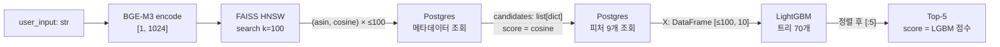

# 03. Two-stage 모델 구조 (Retrieval → Reranking)

> 기준: `main` @ `e7cb606` (2026-10-12). 코드는 수정하지 않았습니다.
>
> **근거를 어디서 가져왔는지 먼저 밝힙니다.** BGE-M3 파인튜닝 코드와 FAISS 인덱스 빌드 코드는 레포에 없습니다.
> 그래서 Stage 1의 학습 설정은 다음 세 곳을 읽고 다시 맞춰 봤습니다.
> - 모델 디렉토리의 sentence-transformers 자동 생성 카드: `ml/model/retrieval/bge-m3-finetuned-20260202-120852/README.md`
> - 같은 디렉토리의 `config.json`, `modules.json` 등 설정 파일
> - `deploy/hf-space/DEPLOY.md`
>
> Stage 2는 코드 외에 저장된 모델 파일(`lgbm_reranker_current_features_v1.pkl`)도 직접 열어 봤습니다.
> lightgbm을 import하지 않고 pickle 상태만 꺼내서 실제 트리 수, 파라미터, 검증 곡선을 확인했습니다.
> 각 값 옆에 출처를 적었습니다: **[코드]**, **[모델카드]**, **[설정]**, **[pkl]**, **[문서]**.

## 0. 요약

| | Stage 1: Retrieval | Stage 2: Reranking |
|---|---|---|
| 모델 | BGE-M3 bi-encoder (XLM-RoBERTa-large), 파인튜닝 | LightGBM `LGBMRanker` (GBDT) |
| 사전학습 체크포인트 | `BAAI/bge-m3` @ `5617a9f6…` | 없음 (처음부터 학습) |
| 입력 → 출력 | 텍스트 → 1024차원 단위 벡터 | 피처 10개 → 스칼라 점수 |
| 손실 | MultipleNegativesRankingLoss (scale 20, cosine) | LambdaRank (NDCG@k 가중 pairwise) |
| 네거티브 | 같은 배치의 다른 아이템 31개 (in-batch) | 같은 쿼리의 Top-100 중 정답이 아닌 99개 (리트리버가 뽑은 hard negative) |
| 학습 설정 | AdamW(fused), lr 5e-5, linear decay, warmup 0, batch 32, 2 epoch, fp16 | lr 0.05, 31 leaves, depth 5, 트리 70개 (최대 2000, early stop 50) |
| 검색/스코어링 | FAISS `IndexHNSWFlat(M=16)`, efSearch 100, 정규화 벡터의 L2 = cosine, k=100 | 후보 ≤100개 전부 점수 매기고 정렬 → Top-5 |
| 서빙 코드 | `backend/app/services/retrieval.py` | `backend/app/services/reranking.py` |
| 학습 코드 | **레포에 없음** | `ml/item_ranker/modeling/train/train_lgbm.py` |



---

## Stage 1. Retrieval: 파인튜닝한 BGE-M3 + FAISS HNSW

### 1.1 모델·체크포인트·차원

| 항목 | 값 | 출처 |
|---|---|---|
| 베이스 | `BAAI/bge-m3`, revision `5617a9f61b028005a4858fdac845db406aefb181` | [모델카드] L146 |
| 산출물 | `ml/model/retrieval/bge-m3-finetuned-20260202-120852/` (`model.safetensors`, fp32 약 2.1 GB) | [설정] `config.json` `"dtype": "float32"` |
| 백본 | `XLMRobertaModel` | [설정] `config.json` |
| 출력 차원 | **1024** | [설정] `1_Pooling/config.json` `word_embedding_dimension` |
| 최대 입력 길이 | **512 토큰** (백본의 위치 임베딩은 8194까지 지원하지만 ST 설정에서 512로 자름) | [설정] `sentence_bert_config.json` |
| 유사도 | cosine | [설정] `config_sentence_transformers.json` `similarity_fn_name` |
| 학습 환경 | sentence-transformers 5.2.0, transformers 4.57.6, torch 2.9.1+cu128 | [설정] |

BGE-M3는 원래 dense, sparse(lexical), multi-vector(ColBERT) 출력을 모두 낼 수 있는 모델입니다.
여기서는 sentence-transformers로 불러서 **dense CLS 벡터만** 씁니다. sparse 가중치나 ColBERT 헤드는 저장되어 있지 않고 사용되지도 않습니다.

### 1.2 아키텍처

[설정] `modules.json`에 정의된 3단 파이프라인입니다.

| # | 모듈 | 구성 | 출력 shape |
|---|---|---|---|
| 0 | `sentence_transformers.models.Transformer` | XLM-R large: **24층**, hidden 1024, attention head 16, FFN 4096, GELU, dropout 0.1, 절대 위치 임베딩, vocab 250,002 (SentencePiece) | `[B, L≤512, 1024]` |
| 1 | `models.Pooling` | **CLS 토큰** pooling (`pooling_mode_cls_token: true`, mean/max는 꺼짐) | `[B, 1024]` |
| 2 | `models.Normalize` | L2 정규화 | `[B, 1024]`, ‖v‖=1 |

- **"head"는 따로 없습니다.** projection layer 없이 CLS hidden state를 정규화한 값이 그대로 임베딩입니다.
- **README는 "Two-Tower"라고 부르지만 실제로는 가중치를 공유하는 Siamese bi-encoder입니다.** 쿼리와 아이템이 같은 `SentenceTransformer` 하나를 통과합니다.
  쿼리/문서 prompt도 비어 있습니다(`"prompts": {"query": "", "document": ""}`). 그래서 쿼리와 아이템을 구분하는 입력 신호가 없습니다.
  - 아이템 쪽: `embedding_text = "[Title] … [Review Keywords] … [Description Summary] … [Features] …"`
  - 쿼리 쪽: 사용자 문장

**forward (sentence-transformers가 실제로 하는 일을 요약)**

```python
tok = tokenizer(texts, truncation=True, max_length=512)    # [B, L]
h   = xlm_roberta(**tok).last_hidden_state                  # [B, L, 1024]
emb = h[:, 0]                                               # CLS pooling → [B, 1024]
emb = F.normalize(emb, p=2, dim=1)                          # Normalize 모듈
```

**서빙에서 호출하는 부분** — [retrieval_resources.py:45](../../backend/app/services/retrieval_resources.py:45), [retrieval.py:47-48](../../backend/app/services/retrieval.py:47)

```python
model = SentenceTransformer(MODEL_PATH)                                  # 기동 시 1회
vec = model.encode([query], convert_to_numpy=True).astype("float32")     # [1, 1024]
faiss.normalize_L2(vec)   # 모델에 이미 Normalize가 있어 중복이지만 무해
```

### 1.3 Loss와 negative sampling

[모델카드] L259-265: `MultipleNegativesRankingLoss(scale=20.0, similarity_fct=cos_sim, gather_across_devices=False)`

```python
# sentence_transformers.losses.MultipleNegativesRankingLoss (라이브러리 동작 요약)
q = model(queries)          # [B, 1024]  sentence_0
d = model(positives)        # [B, 1024]  sentence_1
scores = cos_sim(q, d) * 20.0                        # [B, B]
loss = F.cross_entropy(scores, torch.arange(B))      # 대각선이 정답
```

- **네거티브는 in-batch만 씁니다.** batch 32에서 쿼리 하나당 positive 1개와 같은 배치의 다른 아이템 텍스트 31개를 비교합니다.
  학습 쌍에 hard negative 열(`sentence_2`)이 없고, 리트리버로 hard negative를 따로 뽑는 단계도 없습니다.
- **false negative가 생길 수 있습니다.** positive는 상품의 `embedding_text`이므로, 같은 상품에 달린 리뷰들은 모두 **똑같은 positive 문자열**을 가집니다.
  배치 샘플러는 기본값(`batch_sampler: batch_sampler`, [모델카드] L395)이고 `NO_DUPLICATES`가 아닙니다.
  그래서 리뷰가 많은 인기 상품의 쌍 두 개가 한 배치에 들어가면, 자기 정답과 같은 텍스트가 네거티브로 계산됩니다.
- temperature는 1/20 = 0.05이고, 멀티 GPU에서 네거티브를 모으는 옵션은 꺼져 있습니다(`gather_across_devices=False`).

### 1.4 학습 하이퍼파라미터 ([모델카드] L271-346)

| 항목 | 값 |
|---|---|
| 학습 데이터 | 905,650쌍. 컬럼 `sentence_0`(query), `sentence_1`(positive) |
| batch size | 32 (`per_device_train_batch_size`, gradient accumulation 1) |
| epoch | 2 (`max_steps=-1`) → 약 56,600 step (`905,650 / 32 × 2`). 로그 마지막 step은 56,500 |
| optimizer | `adamw_torch_fused`, β=(0.9, 0.999), ε=1e-8, **weight decay 0.0** |
| learning rate | 5e-5 |
| scheduler | `linear` (최댓값에서 0까지 선형 감소), **warmup 0** (ratio, steps 모두 0) |
| gradient clipping | `max_grad_norm=1` |
| 정밀도 | fp16 (O1) |
| seed | 42 |
| 학습 중 평가 | 없음 (`eval_strategy: no`) |
| 학습 손실 | 1.21 (step 500) → 0.82 (1k) → … → 0.38 (56.5k) |

**학습 데이터 출처가 불명확합니다.**
- 문서(README "Approach A")는 "리뷰 원문을 쿼리로 사용"했다고 씁니다.
- 레포의 Beam 코드(`ml/pipeline/transforms/pairs.py:EmitTrainingPairsFn`)는 **키워드 나열**(`", ".join(keywords[:20])`)을 쿼리로 만듭니다.
  그 결과물인 로컬 `training_pairs.jsonl`은 **518,393줄**이라 905,650과 맞지 않습니다.
- 모델카드의 샘플 쿼리에는 키워드 나열(`"wig, pre-styled, natural, …"`)과 리뷰 문장(`"It's gives the hair good treatment"`)이 **섞여** 있습니다.

따라서 배포된 모델은 **리뷰 문장 쿼리와 키워드 쿼리를 합친 데이터**로 학습했을 가능성이 높습니다.

> **추가 확인 (04 문서 §3.2):** git 기록의 `create_training_pairs.py QUERY_TYPE=both`가 이 데이터를 만듭니다. 약 1.0M쌍에서 `finetune_bge_m3.py`가 10%를 검증용으로 떼면 약 905K이 남고, 모델카드의 905,650과 맞습니다. 해당 코드는 현재 `main`에는 없고 git 기록에만 있습니다.

공개 지표 [문서]: Valid Recall@100 0.2015(베이스) → 0.3543, Test 0.3728.

### 1.5 인덱스와 검색 파라미터

| 항목 | 값 | 출처 |
|---|---|---|
| 인덱스 | `faiss.IndexHNSWFlat(1024, 16)`. HNSW 그래프에 원본 벡터를 압축하지 않고 저장 (PQ/SQ 없음) | [문서] DEPLOY.md Phase B (빌드 코드 없음) |
| M (이웃 수) | 16 | 〃 |
| efConstruction | 200 | 〃 |
| efSearch | **100** (환경변수 `ANN_EF_SEARCH`) | [코드] [retrieval_resources.py:38,49](../../backend/app/services/retrieval_resources.py:38) |
| 거리 | `METRIC_L2` (IndexHNSWFlat 기본값). 단위 벡터라 `d = ‖q−x‖² = 2 − 2cos` | [코드] retrieval.py:53 주석 |
| 점수 환산 | `cosine = 1 − d/2` | [코드] [retrieval.py:53](../../backend/app/services/retrieval.py:53) |
| top-k | **100** (`retrieve_candidates(query, n=100)` 기본값, 라우트에서 바꾸지 않음) | [코드] [retrieval.py:42](../../backend/app/services/retrieval.py:42) |
| 규모 | 112K 벡터, 인덱스 약 477 MB, `asins.json[i]`가 인덱스 행 i에 대응 | [문서] |
| 벡터 정밀도 | DB의 `halfvec`(fp16)를 fp32로 읽어서 빌드 → 아이템 벡터는 fp16으로 한 번 양자화됨. 쿼리는 fp32 | [문서] + `init.sql` |
| 필터 | 없음 (가격, 평점 등 메타데이터 조건 없이 순수 ANN) | [코드] |

```python
# retrieval.py:50-56
distances, indices = ann_index.search(vec, n)          # [1, 100], [1, 100]
ranked = [
    (ann_asins[idx], 1.0 - float(dist) / 2.0)          # squared-L2 of unit vecs -> cosine
    for idx, dist in zip(indices[0], distances[0])
    if idx != -1
]
```

efSearch가 k(100)와 같습니다. HNSW는 `max(efSearch, k)` 크기의 후보 리스트를 쓰므로 탐색 여유분이 없는 설정입니다.
정확한 검색 대비 ANN recall을 잰 기록은 레포에 없습니다.

---

## Stage 2. Reranking: LightGBM LambdaRank

### 2.1 모델·체크포인트·입력 차원

| 항목 | 값 | 출처 |
|---|---|---|
| 모델 | `lightgbm.sklearn.LGBMRanker`, `boosting_type='gbdt'` | [pkl] |
| 사전학습 | 없음 (트리 모델, 처음부터 학습) | |
| 산출물 | `ml/model/reranking/lgbm_reranker_current_features_v1.pkl` (pickle 형식) | [코드] reranking.py:22 |
| 입력 | 피처 **10개**, 순서는 `FEATURE_NAMES`와 같아야 함 | [pkl] `feature_names`, [코드] reranking.py:25 |
| 출력 | 쿼리 안에서 순위를 매기는 데만 쓰는 스칼라 점수 (확률 아님, 범위 제한 없음) | |

**피처 10개**와 학습 데이터에서의 값 범위([pkl] `feature_infos`):

| # | 피처 | 학습 범위 | 서빙에서 가져오는 곳 |
|---|---|---|---|
| 0 | `retrieval_score` | 0.188 ~ 0.853 | Stage 1의 cosine (쿼리마다 다름) |
| 1 | `review_cnt` | 0 ~ 1962 | `products.review_cnt` |
| 2 | `vp_review_cnt` | 0 ~ 1887 | 〃 |
| 3 | `vp_ratio` | 0 ~ 1 | 〃 |
| 4 | `recent_review_cnt` | 0 ~ 96 | 〃 (학습 CSV와 정의가 다름 → [02 문서 부록 A](02_data_flow.md)) |
| 5 | `avg_rating` | 0 ~ 5 | 〃 |
| 6 | `rating_std` | 0 ~ 2.83 | 〃 |
| 7 | `avg_review_len` | 0 ~ 6769 | 〃 |
| 8 | `log_median_price` | 0 ~ 5.55 | 〃 |
| 9 | `price_cnt` | 0 ~ 1 | 〃 |

`retrieval_score`만 쿼리에 따라 바뀌고, 나머지 9개는 **상품에만 의존하는 정적 피처**입니다.
쿼리와 아이템의 텍스트 상호작용(키워드 겹침, 카테고리 일치 등)이나 가격 조건은 피처에 없습니다.

### 2.2 아키텍처 (앙상블 구조)

| 항목 | 값 | 출처 |
|---|---|---|
| 트리 수 | **70** (`n_estimators=2000` 중 early stopping으로 `best_iteration_=70`. 검증 기록은 120 iter에서 끝남 = 70 + patience 50) | [pkl] |
| 트리당 leaf | 최대 31 (`num_leaves=31`), 깊이 5 이하 (`max_depth=5`, 2⁵=32 > 31이라 leaf 수 쪽이 먼저 제한) | [pkl] |
| 출력 | `score = Σ_t f_t(x)` (트리 70개의 leaf 값 합, learning rate가 이미 반영됨). sigmoid 같은 head 없음 | |
| 분기에 쓰인 횟수 (`feature_importances`, split 기준) | `retrieval_score` 875 · `review_cnt` 528 · `vp_review_cnt` 452 · `avg_review_len` 181 · `vp_ratio` 27 · `recent_review_cnt` 13 · `rating_std` 13 · `avg_rating` 6 · `log_median_price` 5 · **`price_cnt` 0** | [pkl] 모델 문자열 |

`price_cnt`는 트리 70개 어디에서도 분기에 쓰이지 않습니다. 평점과 가격 피처도 거의 쓰이지 않습니다.
실제로 쓰이는 신호는 **검색 유사도와 리뷰 수(인기도)** 두 가지입니다.
※ 여기서 중요도는 split 횟수 기준입니다. 학습 코드의 `importance_type="gain"`은 sklearn 속성에만 적용되고, 모델 파일에는 split 횟수가 저장됩니다.

**서빙 forward** — [reranking.py:102-112](../../backend/app/services/reranking.py:102)

```python
X = pd.DataFrame(rows, columns=FEATURE_NAMES)        # [≤100, 10]
scores = _model.predict(X).tolist()                  # best_iteration_(70)까지의 트리 합
...
reranked.sort(key=lambda x: x["score"], reverse=True)
return reranked[:top_k]                              # top_k=5 (routes/recommend.py)
```

### 2.3 Loss와 negative sampling

**손실: LambdaRank** ([pkl] 파라미터: `objective=lambdarank`, `sigmoid=1`, `lambdarank_truncation_level=30`, `lambdarank_norm=1`, `label_gain` 기본값 2^l−1)

- 같은 쿼리 그룹 안에서 (관련 아이템 i, 비관련 아이템 j) 쌍마다 pairwise logistic 손실을 계산합니다: `log(1 + exp(−σ(s_i − s_j)))`.
- 각 쌍의 gradient에 **두 아이템의 순위를 바꿨을 때의 NDCG 변화량 |ΔNDCG|** 를 곱합니다.
- 상위 30위(`truncation_level`) 안에 있는 쌍만 계산하고, `lambdarank_norm`으로 쿼리별 gradient를 정규화합니다.

**라벨과 네거티브** — [dataset/base.py:55](../../ml/item_ranker/dataset/base.py:55), [train_lgbm.py:57](../../ml/item_ranker/modeling/train/train_lgbm.py:57)

```python
# iter_samples: 리뷰를 쓴 상품(parent_asin)만 정답, 나머지 후보는 0
labels.append(1.0 if item_id == target_id else 0.0)

# build_dataset: Top-100 안에 정답이 없는 쿼리는 버림
if not labels or sum(labels) == 0:
    continue
group.append(len(df))
```

- **쿼리 하나 = 그룹 하나 = 후보 100개.** 정답은 1개, 네거티브는 99개입니다.
- 네거티브는 Stage 1 리트리버가 뽑은 Top-100 안의 다른 상품입니다. 별도로 샘플링하지 않았고, 리트리버가 찾은 **hard negative**를 그대로 씁니다.
- 라벨은 0/1 이진값이고 등급형 관련도(graded relevance)는 없습니다.
- 정답이 Top-100 밖인 쿼리는 학습에서 빠집니다(문서 기준 Recall@100 ≈ 0.35, 즉 약 65%가 빠짐).
  그래서 리랭커는 **"정답이 이미 후보 안에 있다"는 조건부 분포**에서만 학습합니다.
- 쿼리는 `retrieval_candidates_*.jsonl`의 `query_text`이고, **영어 리뷰 원문**입니다(02 문서 A-6).
  이 후보 파일을 만든 코드는 없습니다. Recall@100이 일치하므로 배포된 파인튜닝 모델로 만든 것으로 보입니다(2.4).

### 2.4 학습 하이퍼파라미터

[코드] [train_lgbm.py:20-41](../../ml/item_ranker/modeling/train/train_lgbm.py:20), [pkl]로 확인했습니다.

```python
model = lgb.LGBMRanker(
    objective="lambdarank", metric="ndcg", importance_type="gain",
    n_estimators=2000, learning_rate=0.05, max_depth=5, random_state=42,
)
model.fit(
    X_train, y_train, group=group_train,
    eval_set=[(X_valid, y_valid)], eval_group=[group_valid], eval_at=[5, 10],
    callbacks=[lgb.early_stopping(stopping_rounds=50), lgb.log_evaluation(period=50)],
)
```

| 항목 | 값 |
|---|---|
| learning rate | 0.05 (고정. GBDT라 스케줄러 없음) |
| "optimizer" | Gradient boosting. 각 트리가 gradient/hessian으로 leaf 값을 정함 (Newton step) |
| 트리 크기 | `num_leaves=31` (기본값), `max_depth=5`, `min_child_samples=20`, `min_child_weight=1e-3` |
| 정규화 | `reg_alpha=0`, `reg_lambda=0`, `min_split_gain=0` (모두 기본값 = 정규화 없음) |
| 샘플링 | `subsample=1.0`, `colsample_bytree=1.0` (bagging, feature subsampling 없음) |
| 최대 반복 / early stopping | 2000 / 검증 NDCG가 50 iter 동안 개선되지 않으면 중단 → **iter 70에서 최고**, 120에서 종료 |
| 검증 지표 | `ndcg@5`, `ndcg@10` (`first_metric_only=0` → 두 지표 중 하나라도 정체되면 멈춤) |
| 데이터 규모 [문서] | 364K 쿼리 × 100 = 36.4M 행 |
| batch / epoch | 해당 없음 (매 iter마다 전체 데이터 사용) |

**검증 곡선** ([pkl] `_evals_result`)

| iter | NDCG@5 | NDCG@10 |
|---|---|---|
| 1 (트리 1개) | 0.3470 | 0.3836 |
| 70 (best) | **0.3656** | **0.4016** |
| 120 (종료) | 0.3621 | — |

**리트리버 점수 순서만 썼을 때와 비교** (같은 검증 파일, 같은 쿼리 필터. 이번 리뷰에서 계산)

| 순서 | NDCG@5 | NDCG@10 |
|---|---|---|
| `retrieval_score` 내림차순 (리랭커 없음) | 0.2165 | 0.2535 |
| LightGBM (트리 70개) | 0.3656 | 0.4016 |

검증 쿼리는 62,669개이고, 그중 Top-100 안에 정답이 있는 22,203개만 평가했습니다. 이 비율이 Recall@100 = **0.3543**인데, 문서에 적힌 파인튜닝 모델의 Valid Recall@100(0.3543)과 정확히 같습니다.
따라서 이 후보 파일은 **배포된 파인튜닝 BGE-M3로 만든 것**으로 보입니다.

리랭커는 NDCG@5를 0.2165에서 0.3656으로 **약 69% 높입니다**. 트리 1개만으로도 0.347이라, 향상분 대부분은 첫 분기에서 이미 나옵니다.
2.2에서 본 것처럼 이 향상은 주로 `review_cnt`, `vp_review_cnt`(인기도)에서 나옵니다.

이 평가에서는 **리뷰 1건이 쿼리 1개**이고, 정답은 그 리뷰를 쓴 상품입니다. 리뷰가 많은 상품일수록 정답으로 등장하는 횟수도 많습니다.
즉 라벨 분포가 리뷰 수에 비례해서, 인기도 피처가 오프라인 NDCG를 구조적으로 끌어올립니다.
실제 사용자 쿼리에서도 같은 크기의 향상이 나온다고 보기는 어렵습니다. 온라인 지표(CTR/CVR)가 없으므로, 이 69%는 **오프라인 라벨 분포 기준의 향상**이라고 설명해야 합니다.

> **추가 확인 (04 문서 §2.3, §4.2):** 리랭커 피처 CSV의 리뷰 통계는 **valid/test 기간 리뷰까지 포함**합니다(미래 정보 leakage). train 기간 리뷰만 쓴 인기도 정렬의 NDCG@5는 0.1758로 리트리버 순서보다 낮고, CSV 값으로 정렬하면 0.2704입니다. 따라서 이 69%에는 leakage 효과도 섞여 있습니다.

**대안 모델 (실험)** — [train_xgb.py](../../ml/item_ranker/modeling/train/train_xgb.py):
`objective="rank:ndcg"`, `eta=0.05`, `max_depth=5`, `tree_method="hist"`, 최대 2000 round, early stop 50.
서빙에는 쓰지 않습니다.

### 2.5 스코어링 방식

인덱스는 없습니다. Stage 1이 넘긴 후보 ≤100개 **전부**에 점수를 매기고 정렬한 뒤 상위 5개를 자릅니다.
top-k는 [routes/recommend.py](../../backend/app/api/routes/recommend.py)의 `rerank_items(..., top_k=5)`에 하드코딩되어 있습니다.
요청 바디의 `top_k`는 무시됩니다.

README의 latency 표에서 reranking은 약 850 ms입니다. 그런데 트리 70개로 100행을 예측하는 계산은 1 ms 수준입니다.
따라서 이 시간은 대부분 **Postgres 왕복**(`SELECT 1` 연결 확인 + `FEATURE_SQL`)에서 나온다고 봐야 합니다.

---

## 3. 두 stage 사이의 후보 전달

### 3.1 서빙

```mermaid
sequenceDiagram
  participant R as routes/recommend.py
  participant S1 as retrieval.py
  participant PG as Postgres
  participant S2 as reranking.py
  R->>S1: retrieve_candidates(user_input)  n=100
  S1->>S1: FAISS → [(asin, cosine)] ≤100 (ANN 순서)
  S1->>PG: FETCH_SQL (메타데이터 11열)
  S1-->>R: list[dict] ≤100  {item_id, …, score: cosine}
  R->>S2: rerank_items(query, candidates, top_k=5)
  S2->>PG: FEATURE_SQL (같은 asin, 피처 9열)
  S2->>S2: retrieval_score ← c["score"]; predict; sort
  S2-->>R: list[dict] 5  {…, score: LGBM 점수}
```

| 항목 | 내용 | 위치 |
|---|---|---|
| 전달 형태 | Python `list[dict]`. 메모리 안에서 넘기고 직렬화하지 않음 | `routes/recommend.py` |
| 후보 수 | 최대 100개. FAISS의 `-1` 슬롯과 **DB에 없는 ASIN은 빠짐** | retrieval.py:55, retrieval.py 재조립 루프 |
| 넘어가는 신호 | **`score`(cosine) 하나만** 피처로 들어감. ANN 순위나 순위 차이는 피처가 아님 | [reranking.py:90](../../backend/app/services/reranking.py:90) |
| 피처 조회 | 같은 ASIN 목록으로 `products`를 **한 번 더** 조회 (Stage 1의 메타데이터 조회와 같은 테이블) | reranking.py:45, `_fetch_features` |
| 결측 처리 | DB에 피처가 없으면 0.0 | reranking.py:91-99 |
| 출력 `score` | **LGBM 점수로 덮어씀** → API 응답의 `score`는 cosine이 아님 | reranking.py:108 |
| `query` 인자 | `rerank_items`가 받지만 쓰지 않음 | reranking.py:79 |

### 3.2 학습 (오프라인)

```
(쿼리 = 리뷰 원문) ─[코드 없음: 파인튜닝 모델로 Top-100 검색]→ retrieval_candidates_{train,valid}.jsonl
    {parent_asin, query_text, candidates[100]: {item_asin, score, price, average_rating, rating_number, total_helpful_votes, store}}
  ─ iter_samples → RerankSample(candidates=[Candidate(item_id, retrieval_score=score)], labels)
  ─ TreeFeatureBuilder.build (score + CSV 피처 9개) → LGBMRanker.fit
```

후보 파일에는 `price`, `average_rating`, `total_helpful_votes` 같은 메타데이터도 있습니다. 하지만 `TreeFeatureBuilder`는 이것들을 쓰지 않고 별도 CSV에서 피처를 가져옵니다.

### 3.3 학습과 서빙이 서로 다른 부분

| 항목 | 학습 | 서빙 | 영향 |
|---|---|---|---|
| 쿼리 분포 | 영어 리뷰 원문 | 한국어/영어 상황 문장 (UI 예시 4개 중 3개가 한국어) | `retrieval_score` 분포가 달라짐. 가장 중요도가 높은 피처 |
| 후보 검색 경로 | 같은 파인튜닝 모델 (Recall@100이 0.3543으로 일치). 검색 방식(exact 또는 pgvector)은 코드가 없어 모름 | FAISS HNSW (근사) + fp16 아이템 벡터 | 같은 쿼리여도 점수와 후보 집합이 조금 다를 수 있음 |
| 정적 피처 | `item_features_v1.csv` | Beam이 적재한 `products` 컬럼 | `recent_review_cnt` 정의가 다름 (02 부록 A) |
| 후보 수 | 항상 100 (정답 포함 쿼리만) | ≤100 (정답이 있다는 보장 없음) | LambdaRank는 그룹 안 상대 순서만 보므로 영향은 적음 |
| 피처 계약 | `item_ranker/features/tree.py:FEATURE_NAMES` | `backend/app/services/reranking.py:FEATURE_NAMES` (복사본) | 피처 순서가 바뀌어도 잡아낼 테스트가 없음 |

---

## 4. 정리: 모델 관점에서 본 개선 포인트

1. **재현성**: 파인튜닝 스크립트, 학습 데이터 생성 코드(905,650쌍), 후보 생성 코드, FAISS 빌드 코드를 레포에 넣어야 합니다.
   지금은 모델카드와 pkl을 열어야 설정을 알 수 있습니다.
2. **Stage 1 학습**:
   - 같은 상품끼리 생기는 in-batch false negative는 `BatchSamplers.NO_DUPLICATES`로 막을 수 있습니다.
   - batch 32는 MNRL치고 작습니다. `CachedMultipleNegativesRankingLoss`로 메모리를 늘리지 않고 배치를 키울 수 있습니다.
   - 리트리버로 뽑은 hard negative를 추가하는 것도 고려할 만합니다.
   - 쿼리가 영어 리뷰나 키워드인데 서빙 쿼리는 한국어라서, 한국어 쿼리로 검증한 결과가 필요합니다.
3. **Stage 2 피처**: 실제로 쓰이는 건 유사도와 인기도뿐입니다. 쿼리-아이템 상호작용 피처(BM25, 키워드 겹침, cross-encoder 점수)가 없어서 리랭커가 할 수 있는 일이 제한됩니다.
   TODO에 있는 cross-encoder rerank와 같은 방향입니다.
4. **평가**: 리랭커의 오프라인 향상(NDCG@5 +69%)은 "리뷰 1건 = 쿼리 1개" 라벨링 때문에 인기도 피처에 유리하게 부풀려져 있을 가능성이 높습니다.
   인기도만으로 정렬한 기준선(`review_cnt` 내림차순)과, 상품당 쿼리 수를 맞춘 평가셋을 함께 보고하는 것이 좋습니다.
5. **ANN 설정**: `efSearch=100`이 k=100과 같습니다. exact 검색 대비 recall@100을 한 번 재 보고 efSearch를 정하는 것이 좋습니다.
