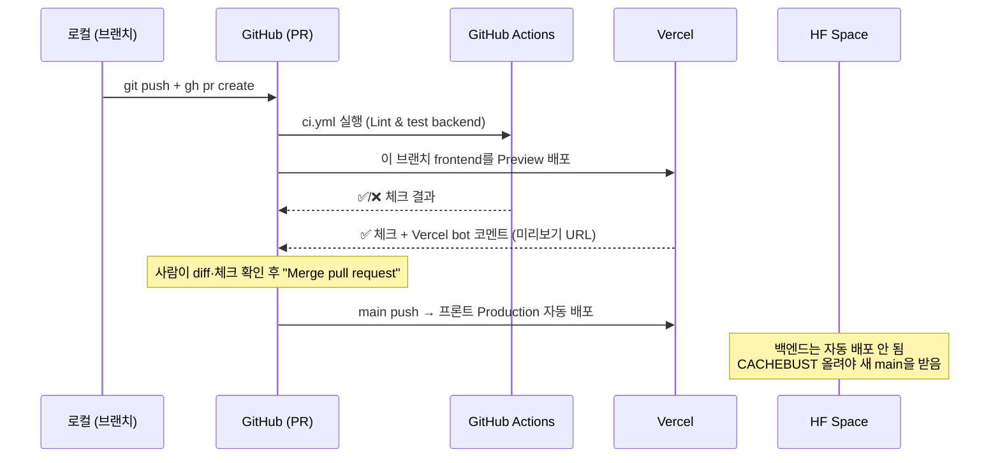

# 06. PR과 CI 체크: 변경이 main에 들어가기까지

> 기준: `main` @ `0234c9b` (2026-10-16). 예시는 workstream 1 정리 PR인
> [#14](https://github.com/kevin7548/ChatBeauty/pull/14)입니다.
> 테스트와 CI 개념 자체(pytest, runner, CD 등)는 [testing-cicd-primer.md](../testing-cicd-primer.md)에
> 더 자세히 있습니다. 이 문서는 **이 레포에서 PR 하나가 실제로 거치는 과정**을 정리합니다.

## 0. 한눈에 보기



PR #14에서 실제로 뜬 체크 3개:

| Check | 누가 실행 | 결과 | 의미 |
|---|---|---|---|
| `Lint & test backend` | GitHub Actions (`.github/workflows/ci.yml`) | pass, 21초 | 백엔드 ruff(권고) + pytest 3개 |
| `Vercel` | Vercel (GitHub 앱 연동) | pass | 이 브랜치의 frontend가 Preview URL에 빌드·배포됨 |
| `Vercel Preview Comments` | Vercel | pass | Preview 사이트 위 코멘트 기능 상태. 신경 쓰지 않아도 됨 |

---

## 1. PR이란

- **"이 브랜치의 변경을 main에 합쳐 달라"는 요청서**입니다. 코드 diff, 설명(What/Why/How), 리뷰 대화, 자동 체크 결과가 한 화면에 모입니다.
- 이 레포는 PR 템플릿([.github/pull_request_template.md](../../.github/pull_request_template.md))을 씁니다: What / Why / How / Related Issue / Checklist.
- main에 직접 push하지 않고 PR을 거치는 이유:
  - 합치기 **전에** CI가 돌아서 깨진 코드가 main에 들어가는 걸 막습니다.
  - "왜 바꿨는지"가 PR 설명으로 남습니다. 나중에 `git log`나 GitHub에서 찾을 수 있고, 면접에서 작업 이력을 보여줄 때도 씁니다.
- Claude Code가 만든 PR도 **사용자 GitHub 계정**으로 열립니다(`gh pr create`). 봇 계정이 아닙니다.

### Merge는 사람이 합니다

- PR 페이지의 **Merge pull request** 버튼을 직접 누릅니다. Claude는 요청이 없으면 merge하지 않고, auto-merge도 켜지 않습니다.
- 버튼을 누르기 전 확인할 것:
  1. 체크가 모두 ✅인지
  2. merge 상태가 `MERGEABLE` / `CLEAN`인지 (충돌 없음)
  3. **Files changed** 탭에서 diff를 한 번 훑었는지 (의도하지 않은 파일이 섞이지 않았는지)
- merge 후 로컬 정리:
  ```bash
  git checkout main && git pull && git branch -d <브랜치명>
  ```
  GitHub에서 "Delete branch" 버튼을 누르면 원격 브랜치도 지워집니다.

---

## 2. `Lint & test backend` — GitHub Actions CI

정의 파일: [.github/workflows/ci.yml](../../.github/workflows/ci.yml)

### 언제 도나

- **모든 PR**(새 커밋을 push할 때마다 다시 돎)과 **main에 push될 때**.
- GitHub가 빌려주는 깨끗한 Ubuntu 가상머신(runner)에서 돕니다. 내 노트북 상태와 무관하게 "처음부터 설치해도 통과하는가"를 봅니다.

### 무엇을 하나 (단계별)

| 단계 | 내용 | 실패 시 |
|---|---|---|
| checkout | 이 PR의 코드를 받음 | — |
| setup-python | Python 3.12 설치 (pip 캐시 사용) | — |
| Install dependencies | `fastapi`, `python-dotenv`, `pytest`, `httpx`, `ruff`**만** 설치 | 빌드 실패 |
| Lint (ruff) | `ruff check .` — 스타일·잠재 버그 검사 | **실패해도 통과** (`continue-on-error: true`, 권고 모드) |
| Run tests | `python -m pytest -v` | **PR 체크가 ❌** — 이게 실제 관문 |

### 테스트가 실제로 확인하는 것

[backend/tests/test_recommend.py](../../backend/tests/test_recommend.py)의 3개:

1. `POST /recommend` 정상 요청 → 200, 추천 **5개**, 각 항목이 `ItemScore` 스키마에 맞음, 설명이 `item_id`로 올바르게 붙음, latency 4단계 키 존재, `X-Total-Latency-Ms` 헤더 존재
2. 공백 입력 → 200 + 빈 리스트
3. `user_input` 누락 → 422

### 핵심 트릭: 서비스를 가짜(stub)로 바꿔서 돈다

- `app.main`을 import하면 BGE-M3 로드, FAISS 인덱스 로드, DB 연결, LightGBM pickle 로드, Gemini 키 검사가 **import 시점에** 일어납니다 [01 §2.4].
- CI에는 모델(수 GB)도, DB도, Gemini 키도 없습니다. 그래서 [conftest.py](../../backend/tests/conftest.py)가 서비스 모듈 4개를 `sys.modules`에 **가짜로 먼저 넣어둔 뒤** 앱을 import합니다.
- 라우트(`api/routes/recommend.py`)는 진짜라서, **retrieve → rerank → explain을 엮는 코드와 응답 형식**은 검증됩니다.
- 덕분에 torch 같은 무거운 의존성 없이 약 20~40초에 끝납니다.

### 그래서 CI가 **확인하지 않는** 것

| 확인 안 됨 | 예시 |
|---|---|
| 실제 모델이 로드되는가 | 모델 경로 기본값이 틀려도 CI는 통과 |
| FAISS 인덱스·DB와 연결되는가 | compose에 `ann/` 마운트가 빠져 있어도 CI는 통과 (실제로 그랬음, [01 §5-1]) |
| Docker 이미지가 빌드되는가 | Dockerfile 오류는 CI가 못 잡음 |
| 추천 **품질** | Recall/NDCG는 CI 대상이 아님 (workstream 2의 평가 하네스 몫) |
| 프론트·ML 코드 | 프론트 테스트·ML 테스트는 없음 (프론트는 Vercel 빌드 성공 여부만 간접 확인) |

→ 이 공백을 메우는 게 **로컬 `docker compose up` 확인**입니다(§5).

---

## 3. Vercel bot과 Vercel 체크

- 사용자 Vercel 계정이 GitHub 레포에 연결돼 있어서 **자동으로 반응하는 외부 서비스**입니다. `ci.yml`과 무관합니다.
- PR이 열리면: 이 브랜치의 `frontend/`를 빌드해서 **임시 Preview URL**에 배포 → 결과를 `Vercel` 체크로 표시 → bot이 Preview 링크를 PR 코멘트로 남김.
- 이 코멘트는 **코드 리뷰가 아니라 배포 알림**입니다. 고칠 내용이 없습니다(#14에서 Auto-fix가 "새 코멘트"로 알렸지만 무시한 이유).
- 쓸모: 프론트를 바꾼 PR이면 Preview URL에서 화면을 미리 확인할 수 있습니다. 다만 Preview도 **프로덕션 백엔드(HF Space)**를 부를 수 있으니 `VITE_API_URL` 설정을 확인하세요.
- main에 merge되면 Vercel이 **프로덕션에 자동 배포**합니다(이게 이 레포의 유일한 자동 CD).

---

## 4. 체크가 실패했을 때 / Auto-fix

- PR에서 ❌가 뜨면 체크 옆 **Details** → 로그에서 실패한 단계를 찾습니다. pytest 실패면 어떤 `assert`가 깨졌는지 나옵니다.
- 로컬에서 같은 조건으로 재현:
  ```bash
  cd backend && python -m pytest -v
  ```
- 고친 커밋을 같은 브랜치에 push하면 CI가 자동으로 다시 돕니다. PR을 새로 만들 필요 없습니다.
- **Auto-fix** (Claude 데스크톱 앱 기능): 켜두면 앱이 PR을 지켜보다가 CI 실패·merge 충돌·리뷰 코멘트가 생길 때 Claude 세션을 깨워 고치고 push합니다. merge는 하지 않습니다.

---

## 5. 왜 로컬 `docker compose up` 확인이 필요한가

**CI는 "코드 조립이 맞는가"만 보고, "진짜 부품을 끼우면 켜지는가"는 보지 않기 때문**입니다(§2 표).

- workstream 1에서 바꾼 것 중 상당수가 정확히 CI가 못 보는 영역입니다:
  - 모델 기본 경로 `ml/model-gcs/` → `ml/model/`
  - compose 볼륨 마운트 (`ml/model/` 전체 → FAISS `ann/` 포함)
  - Dockerfile 주석과 `.env` 로딩 순서
- 이 변경들이 맞는지 확인하는 유일한 방법은 **실제 모델·인덱스·DB로 서버를 띄우고 `/recommend`를 호출해 보는 것**입니다. 서비스 모듈이 import 시점에 모델을 로드하므로, 경로가 하나라도 틀리면 서버가 아예 안 뜹니다.
- 프로덕션(HF Space)은 `start.sh`가 경로를 env로 직접 넘겨서 이 변경의 영향을 받지 않습니다. 그래서 **로컬 개발 경로가 고쳐졌는지는 로컬에서만** 확인됩니다.
- 이후 workstream(2: 평가 하네스, 4: DB 제거)은 로컬에서 서버를 띄울 수 있다는 걸 전제로 하므로, 그 전에 한 번 확인해 두는 게 좋습니다.

절차 ([development.md](../development.md)):

```bash
hf download kevin7548/chatbeauty-models --local-dir ml/model   # 모델 + FAISS 인덱스 (~2.6GB)
cd backend && cp .env.example .env    # GEMINI_API_KEY 입력
docker compose up --build
curl http://localhost:8080/health
curl -X POST http://localhost:8080/recommend -H "Content-Type: application/json" \
  -d '{"user_input":"gentle moisturizer for dry skin"}'
```

주의: compose의 `db`는 빈 로컬 Postgres입니다. 상품 데이터가 없으면 FAISS가 찾은 ASIN을 DB에서 못 찾아 추천이 비어 나옵니다. 실제 결과를 보려면 Beam으로 로컬 DB를 채우거나, `docker-compose.yml`의 `environment: DATABASE_URL`을 Supabase URL로 바꿔야 합니다. compose의 `environment` 값이 `.env`보다 우선하므로 `.env`만 고쳐서는 안 바뀝니다. 그래도 `/health` 응답과 서버 기동 자체는 빈 DB로도 확인됩니다(이번 확인의 핵심).

---

## 6. 이 레포의 다른 workflow: keepalive

- [.github/workflows/keepalive.yml](../../.github/workflows/keepalive.yml)은 PR과 무관하게 **월·목 cron**으로 돕니다.
- HF Space가 죽어 있으면 재시작하고, 실제 `/recommend`를 호출해서 Supabase가 auto-pause되지 않게 합니다.
- PR 체크 목록에는 나오지 않습니다. 실패하면 GitHub가 이메일을 보냅니다(무료 가동 모니터링 역할).

---

## 7. 용어 정리

| 용어 | 뜻 |
|---|---|
| PR (Pull Request) | 브랜치 변경을 main에 합쳐 달라는 요청 + 리뷰 공간 |
| CI | 변경마다 자동으로 테스트/린트를 돌려 main을 보호하는 것 |
| CD | 통과한 변경을 자동 배포하는 것. 이 레포는 Vercel(프론트)만 자동, 백엔드는 수동 |
| GitHub Actions | GitHub의 CI 실행 서비스. `.github/workflows/*.yml`로 정의 |
| runner | Actions가 작업을 돌리는 임시 가상머신 |
| check | PR 화면에 뜨는 ✅/❌ 한 줄. Actions job 또는 외부 서비스(Vercel)가 보고 |
| stub | 테스트용 가짜 구현. 여기선 모델/DB/Gemini 대신 고정 데이터를 돌려줌 |
| Preview 배포 | PR 브랜치 전용 임시 사이트 (Vercel) |
| CACHEBUST | HF Space Dockerfile의 빌드 인자. 값을 올려야 새 main을 clone함 |
