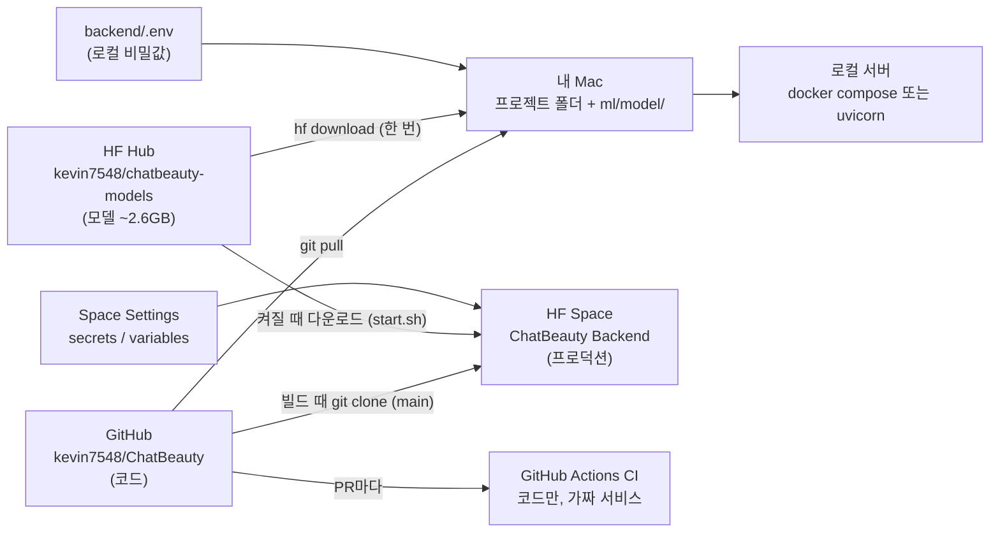

# 07. 코드·모델·설정은 어디에 있고, 서버는 어디서 도나

> 기준: `main` @ `0234c9b` (2026-10-16). workstream 1을 하면서 헷갈렸던
> "프로젝트 폴더 / GitHub / HF Hub / HF Space / 로컬 실행"의 관계를 정리한 문서입니다.
> PR과 CI 자체는 [06](06_pr_ci_workflow.md), 배포 절차는 [DEPLOY.md](../../deploy/hf-space/DEPLOY.md)에 있습니다.

## 0. 한 줄 요약

**코드는 GitHub, 모델은 HF Hub, 비밀값은 `.env` 또는 Space Settings에 있습니다.**
셋을 HF 서버에서 합치면 프로덕션, 내 Mac에서 합치면 로컬 실행입니다. CI는 코드만 가지고 가짜로 돌려 봅니다.



---

## 1. 서버에 필요한 재료는 세 가지

| 재료 | 내용 | 크기 | 보관 장소 | 왜 거기에 |
|---|---|---|---|---|
| **코드** | `backend/app/*.py` (FastAPI, 검색·리랭크·설명 로직) | 수백 KB | **GitHub** `kevin7548/ChatBeauty` | 버전 관리, PR, CI |
| **모델 파일** | BGE-M3, FAISS 인덱스(`retrieval/ann/`), LightGBM `.pkl` | 약 2.6 GB | **HF Hub** `kevin7548/chatbeauty-models` | GitHub는 큰 파일을 못 올림 (`.gitignore`가 `ml/model/**` 제외) |
| **비밀값·설정** | `GEMINI_API_KEY`, `DATABASE_URL`(Supabase), `ALLOWED_ORIGINS` | 몇 줄 | 로컬 `backend/.env` / Space Settings | 비밀값은 git에 올리면 안 됨 |

비유하면 GitHub는 레시피, HF Hub는 식재료 창고, Space는 그 둘을 받아 요리하는 주방입니다.
HF Space 페이지에 `Models: kevin7548/chatbeauty-models`가 표시되는 건 이 창고와 연결되어 있다는 뜻입니다.

---

## 2. HF Space는 어떻게 켜지나 (프로덕션)

Space는 **두 단계**로 재료를 가져옵니다.

| 단계 | 언제 | 파일 | 하는 일 |
|---|---|---|---|
| **빌드** | Space를 (다시) 빌드할 때 | [Dockerfile](../../deploy/hf-space/Dockerfile) | Python 설치 → **GitHub main을 `git clone`** → Python 패키지 설치. 모델은 아직 안 받음 |
| **기동** | 컨테이너가 켜질 때마다 | [start.sh](../../deploy/hf-space/start.sh) | **HF Hub에서 모델 다운로드** → 모델 경로 4개를 환경변수로 지정 → `uvicorn` 실행 (포트 7860) |

```dockerfile
ARG REPO_URL=https://github.com/kevin7548/ChatBeauty
ARG REPO_REF=main
ARG CACHEBUST=1
RUN echo "cachebust=${CACHEBUST}" && git clone --depth 1 --branch ${REPO_REF} ${REPO_URL} src
```

- "GitHub main을 clone한다"는 건 **GitHub에 push된 main 브랜치의 코드**를 받는다는 뜻입니다. 내 Mac의 프로젝트 폴더가 아닙니다.
- "models에서 끌어다 쓴다"도 맞습니다. 코드는 GitHub에서, 모델은 HF Hub에서 **각각** 가져옵니다.
- **main에 merge해도 Space는 자동으로 안 바뀝니다.** Docker는 빌드 단계를 캐시하므로, clone 줄은 다시 실행되지 않고 예전 코드를 씁니다. Space의 Dockerfile에서 `CACHEBUST` 값을 올려 다시 업로드해야 새 main을 clone합니다.
- Space에는 `.env` 파일이 없습니다. 같은 값을 Space Settings의 secrets(`DATABASE_URL`, `GEMINI_API_KEY`)와 variables(`MODEL_REPO_ID`, `ALLOWED_ORIGINS`)에 넣어 두었습니다.

### 프로젝트의 `deploy/hf-space/` 폴더는 무엇인가

**Space를 만드는 설계도 원본**입니다. Space는 GitHub 레포와 자동 연결되어 있지 않아서, 아래 세 파일을 Space 레포에 **직접 업로드**해 두었습니다.

| 파일 | 어디서 쓰이나 | 역할 |
|---|---|---|
| `Dockerfile` | Space에 복사됨 | 빌드 방법 (위 표) |
| `start.sh` | Space에 복사됨 | 기동 방법 (위 표) |
| `README.md` | Space에 복사됨 | Space 설정 카드 (이름, Docker 타입, 포트 7860) |
| `upload-models.sh` | **내 Mac**에서 한 번 실행 | 로컬 `ml/model/`의 BGE-M3와 LightGBM을 HF Hub에 업로드 |
| `DEPLOY.md` | 사람이 읽음 | 배포 전체 절차서 |

`upload-models.sh`는 FAISS 인덱스를 올리지 않습니다. 인덱스는 Colab에서 만들어 DEPLOY.md Phase B 절차대로 따로 올렸습니다. 그래서 로컬에는 원래 인덱스가 없었습니다(§4).

---

## 3. 같은 백엔드를 돌리는 세 가지 방식

**uvicorn**은 FastAPI 앱(`app/main.py`)을 실행해 HTTP 요청을 받게 해 주는 파이썬 웹 서버입니다. 어디서 돌든 "백엔드가 켜졌다"는 건 uvicorn이 `app.main:app`을 실행 중이라는 뜻입니다. **Docker**는 그 uvicorn을 Python·패키지와 함께 상자(컨테이너)에 담아 어디서나 똑같이 돌게 해 주는 도구입니다.

| | ① 프로덕션 | ② docker compose | ③ uvicorn 직접 실행 |
|---|---|---|---|
| **어디서** | HF 서버 (Space) | 내 Mac 안의 Docker 컨테이너 | 내 Mac에서 바로 |
| **Docker** | 사용 (HF가 대신 빌드) | 사용 (Mac에 Docker 필요) | 사용 안 함 |
| **코드** | GitHub main clone | 내 프로젝트 폴더 | 내 프로젝트 폴더 |
| **모델** | 켜질 때 HF Hub에서 다운로드 | 로컬 `ml/model/`을 컨테이너에 마운트 | 로컬 `ml/model/` |
| **비밀값** | Space Settings | `backend/.env` | `backend/.env` |
| **DB** | Supabase | compose의 빈 로컬 Postgres (기본값) | `.env`의 `DATABASE_URL` (Supabase) |
| **주소** | `https://<user>-<space>.hf.space` | `http://localhost:8080` | `http://127.0.0.1:8000` |
| **설정 파일** | `deploy/hf-space/Dockerfile`, `start.sh` | `backend/Dockerfile`, `backend/docker-compose.yml` | 없음 (셸 명령) |

- "HF Space에서 Docker를 돌린다"는 ①입니다. HF 서버에서 일어나는 일이라 내 Mac과는 관계없습니다.
- workstream 1의 로컬 확인은 ③으로 했습니다. Mac에 Docker가 없어서 ②를 못 했고, 같은 코드를 Docker 상자 없이 Mac에서 바로 실행했습니다. 결과는 [06 §5](06_pr_ci_workflow.md#5-왜-로컬-docker-compose-up-확인이-필요한가)에 있습니다.
- ③은 "모델이 로드되고 서버가 켜지는가"는 확인하지만, "compose가 폴더를 올바로 마운트하는가"는 확인하지 못합니다.

### `.env` 파일

- 서버가 읽을 **비밀값과 설정을 적어 두는 로컬 파일**입니다. `.gitignore`가 막기 때문에 git에 올라가지 않아서 API 키를 넣어도 안전합니다. 템플릿은 [`.env.example`](../../backend/.env.example)입니다.
- ②와 ③에서만 쓰입니다.
  - ②에서는 compose가 `env_file: .env`로 넣어 주는데, compose 파일의 `environment:` 값(`DATABASE_URL`)이 `.env`보다 우선합니다.
  - ③에서는 `app/main.py`의 `load_dotenv()`가 읽습니다.
- PR #14에서 `load_dotenv()`를 라우트 import **앞으로** 옮긴 이유: 서비스 모듈이 import되는 순간 `DATABASE_URL`과 모델 경로를 읽습니다. 그래서 전에는 ③으로 실행하면 `.env`를 읽기 전에 DB 주소가 이미 기본값 `localhost`로 정해졌습니다.

---

## 4. 로컬 확인에서 모델을 왜 다시 받았나

- 로컬 서버(②③)는 HF Hub를 직접 읽지 못하고, **디스크의 `ml/model/`**에서 파일을 읽습니다. HF Hub의 모델은 Space가 가져다 쓰라고 둔 것입니다.
- 로컬에는 원래 BGE-M3와 LightGBM만 있었고 **FAISS 인덱스가 없었습니다**(§2 참고). 인덱스가 없으면 `faiss.read_index`에서 서버가 기동하지 못합니다.
- 그래서 `hf download kevin7548/chatbeauty-models --local-dir ml/model`을 실행했고, 이미 있던 BGE-M3(2.1 GB)는 건너뛰고 **FAISS 인덱스(477 MB)만 새로 받았습니다.**

---

## 5. 각 확인이 보는 범위

| 확인 | 코드 연결 | 진짜 모델 로드 | DB·Gemini 연결 | compose 마운트 | 프로덕션 반영 |
|---|---|---|---|---|---|
| CI (pytest, 가짜 서비스) | ✅ | ❌ | ❌ | ❌ | ❌ |
| ③ uvicorn 직접 실행 | ✅ | ✅ | ✅ | ❌ | ❌ |
| ② docker compose | ✅ | ✅ | DB는 설정에 따라 | ✅ | ❌ |
| ① Space 재빌드 후 `/recommend` | ✅ | ✅ | ✅ | 해당 없음 | ✅ |

- CI는 PR마다 자동으로 돌고, ②③은 로컬 실행 경로를 바꿨을 때 직접 돌립니다.
- ①은 백엔드 코드를 바꾼 뒤 `CACHEBUST`를 올려 재빌드할 때 확인합니다. keepalive workflow(월·목)도 실제 `/recommend`를 불러서 ①이 살아 있는지 봅니다.
