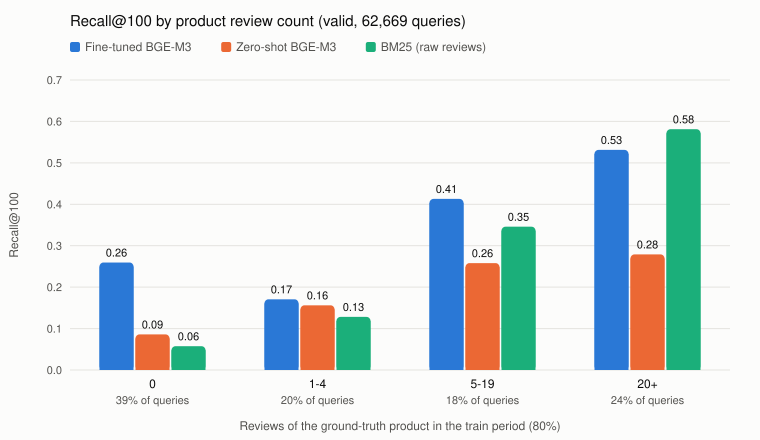

# 실험 B 결과 요약 (2026-10-25, test 재현 2026-11-03)

평가: valid 62,669 쿼리. 20자 이상 리뷰를 timestamp로 정렬해 80/10/10으로 나눴다. 쿼리는 리뷰 원문, 정답은 그 리뷰의 `parent_asin` 1개다. 코퍼스는 `items_for_embedding.jsonl` 112,589개, 시드는 42다.
리뷰 수는 학습 구간(앞 80%) 기준으로 센다. 분할이 리뷰 단위라서 "cold-start"가 아니라 "리뷰가 적은 상품"으로 표현한다. B3(리랭커 NDCG)는 팀 리랭커 NDCG가 누수된 값이라 하지 않았다.

> **기준값은 Valid Recall@100 0.334(S1)다.** 기존 문서의 0.3543은 평가 기간(valid·test) 리뷰 키워드가 상품 텍스트에 섞인 상태에서 나온 값으로 보인다(아래 "B0 기준값과의 차이"). 이 문서의 모든 비교는 누수 없는 현재 코퍼스(학습 구간 키워드만)로 했다.

| 소스 | 구현 |
|---|---|
| S1 | 파인튜닝 BGE-M3 (`bge-m3-finetuned-20260202-120852`), flat 정확 검색, max_seq_length 512 |
| S2 | zero-shot `BAAI/bge-m3`, S1과 같은 조건 (둘 다 Colab T4, fp16, 모델당 약 16분) |
| S3 | BM25 (bm25s, 영어 불용어 + Snowball). 문서는 제목 + 원본 description + features + 학습 구간 원문 리뷰 (`categories`도 넣었지만 원본 메타데이터부터 100% 비어 있어 효과 없음) |

## B1. 소스별 Recall

| 소스 | R@10 | R@50 | R@100 | MRR@100 |
|---|---|---|---|---|
| S1 파인튜닝 BGE-M3 | 0.134 | 0.262 | **0.334** | 0.073 |
| S2 zero-shot BGE-M3 | 0.072 | 0.136 | 0.176 | 0.042 |
| S3 BM25 | 0.125 | 0.206 | 0.248 | 0.073 |

- 파인튜닝 효과: 같은 조건에서 R@100 0.176 → 0.334 (1.9배, +90%). 기존 문서의 "0.2015 → 0.3543 (+75%)"를 대체한다. 0.2015는 ChromaDB 시절 다른 조건(키워드만 쿼리로 1 epoch 학습한 모델)에서 나온 값이라 비교 기준으로 쓰지 않는다.
- BM25는 R@100에서는 S1보다 낮지만 R@10과 MRR은 S1과 비슷하다. 맞힐 때는 상위에 올린다.
- 상세: `experiments/results/B_B1_recall.json`

### BM25 문서 구성 비교 (S3 선택 근거)

| BM25 문서 | R@100 |
|---|---|
| **제목 + 원본 description + features + 원문 리뷰 전체 (S3)** | **0.248** |
| 위와 같되 최근 리뷰 20개만 | 0.229 |
| 리뷰 없이 제목 + 원본 description + features | 0.140 |
| `embedding_text` (제목 + LLM 리뷰 키워드 + 요약 description + features) | 0.160 |

- 쿼리가 리뷰 원문이라 BM25는 원문 리뷰와 단어가 겹칠 때 강하다. LLM이 정규화한 키워드로는 이 이점이 사라진다.
- `embedding_text`와 S3의 차이는 리뷰 부분뿐이다(LLM 키워드 대 원문 리뷰, 요약 description 대 원본 description). 제목과 features는 둘 다 들어간다.
- description 요약본은 BGE-M3 입력 길이를 맞추려고 만든 것이다. 원본 description으로 바꿔도 +0.001 수준이다.
- 필드 채움 비율(상품 112,589개): 제목 100%, 리뷰 키워드 76.1%, 원본 description 17.0%(요약 15.5%), features 15.4%, categories 0%, main_category 100%(99.6%가 "All Beauty"로 변별력 없음). 대부분의 상품은 사실상 제목과 리뷰 키워드로만 표현된다.

### B0 기준값(0.3543)과의 차이: 0.3543을 쓰지 않는 이유 (`B_B0_check.json`)
- B0는 2026-03-22에 ChromaDB로 만든 후보 파일이다. 10/23에 다시 나온 0.3543은 `evaluate_recall.py`로 이 파일을 다시 채점한 값이다. 검색을 새로 한 것이 아니다.
- 원인에서 제외한 것
  - fp16: fp32로 다시 인코딩해도 B0 점수보다 중앙값 0.13 낮다.
  - HNSW 대 flat: 같은 벡터라면 근사 검색은 recall을 올릴 수 없다.
  - 512토큰 잘림: 정답 상품이 512토큰을 넘는 경우 B0 0.586, S1 0.590으로 차이가 없다.
  - 모델·쿼리 인코딩: 둘 다 맞힌 쌍의 89%는 현재 텍스트로 B0 점수가 0.01 이내로 재현된다.
- 차이가 나는 곳: 현재 파일에서 정답 상품의 `review_keywords`가 비어 있는 쿼리(48%)에서만 B0 0.318, S1 0.272로 차이가 난다. 키워드가 있는 상품에서는 B0 0.388, S1 0.392다.
- 재구성 실험: B0만 맞힌 150쌍에서 정답 상품 텍스트에 키워드를 넣고 점수를 다시 계산했다.

| 정답 상품 텍스트 | 점수 − B0 점수 (중앙값) |
|---|---|
| 현재 텍스트 | −0.131 |
| + 학습 구간 키워드 | −0.035 |
| **+ 학습·valid·test 구간 키워드** | **−0.004** |

- **모델 학습 자체는 누수가 없다.** 학습쌍 파일(`training_pairs.jsonl`, 2026-01-29)의 상품 텍스트는 상품 86,834개 모두 현재 `embedding_text`와 글자 단위로 같다. valid·test에만 나오는 키워드가 들어간 상품은 7개뿐이다. 학습 쿼리는 키워드 학습 구간(평가 valid 시작 전에 끝남)에서만 나왔다. 따라서 같은 파인튜닝 모델을 다시 써도 되고, 누수는 3월 평가 때 ChromaDB에 넣은 상품 텍스트에만 있었다. (로컬에 남은 학습쌍 파일은 키워드 쿼리 51.8만 쌍 버전이다. 실제 학습에 쓴 키워드+원문 100만 쌍 버전은 남아 있지 않지만, 같은 스크립트가 같은 상품 파일에서 positive를 가져온다.)
- 결론(추정): ChromaDB 인덱스는 valid·test 기간 리뷰의 키워드까지 들어간 이전 버전의 상품 텍스트로 만들어졌을 가능성이 크다. 그렇다면 0.3543은 누수로 부풀려진 값이다. 옛 파일의 키워드 순서와 형식은 재현할 수 없어서, 개별 점수까지 정확히 맞지는 않는다(0.01 이내는 17%). 현재 코퍼스의 0.334가 누수 없는 값이다.

## B2. 중복 · 기여 · 커버리지

| 지표 | S1 | S2 | S3 |
|---|---|---|---|
| Top-100 Jaccard | S1–S2 0.080 | S2–S3 0.061 | S1–S3 0.093 |
| 고유 기여: 그 소스만 맞힘 (전체 쿼리 대비) | 12.0% | 2.0% | **5.1%** |
| 고유 기여 (합집합 정답 대비) | 28.4% | 4.9% | 12.2% |
| Top-10 커버리지 (한 번이라도 등장한 상품 / 112K) | 76.3% | 53.4% | 66.4% |
| 학습 구간 리뷰 0건 상품의 Top-10 커버리지 | 76.3% | 28.1% | 25.1% |

### S1 + S3 결합 (`fusion.py`, `B_fusion.json`)

각 소스가 Top-100을 따로 뽑은 뒤 합쳐서 최종 후보 K개를 만든다. 리랭커 없이 "정답이 후보에 들어가는가"만 쟀다.

| 결합 방식 | 후보 수 K | Recall@K | 리뷰 0 / 1–4 / 5–19 / 20+ |
|---|---|---|---|
| S1 단독 | 100 | 0.334 | 0.259 / 0.171 / 0.413 / 0.531 |
| **할당: S1 90 + S3 10** (중복은 다음 순위로 채움) | 100 | **0.349** | 0.255 / 0.185 / 0.428 / 0.577 |
| 할당: S1 80 + S3 20 | 100 | 0.349 | 0.246 / 0.188 / 0.427 / 0.590 |
| 할당: S1 70 + S3 30 | 100 | 0.346 | 0.236 / 0.185 / 0.425 / 0.597 |
| 할당: S1 50 + S3 50 | 100 | 0.333 | 0.207 / 0.177 / 0.416 / 0.603 |
| RRF (k=60) | 100 | 0.339 | 0.215 / 0.180 / 0.423 / 0.607 |
| 합집합 (S1 ∪ S3, 중복 제거) | 평균 184 | 0.401 | 0.273 / 0.231 / 0.500 / 0.672 |
| 참고: S1 ∪ S2 / S1 ∪ S2 ∪ S3 | 약 190 / 약 270 | 0.370 / 0.421 | |

- **같은 후보 수(100)에서는 +0.015(0.334 → 0.349)다.** 합집합의 0.401은 후보를 평균 184개로 늘린 값이라 단독 소스와 같은 조건이 아니다.
- BM25 비중을 늘릴수록 리뷰 많은 상품(20+)은 오르고 리뷰 없는 상품(0)은 떨어진다. 전체 최적은 BM25 10~20개다.
- RRF는 순위만 쓰므로 두 소스를 거의 반반으로 섞는 효과가 나서, 리뷰 0건 상품이 많은 이 데이터에서는 할당 방식보다 낮다.

### 후보 수 K를 늘리는 것과 소스를 섞는 것

| 후보 수 K | S1 단독 | S1 + S3 (최적 할당) | S3 몫 |
|---|---|---|---|
| 50 | 0.262 | 0.273 | 10 |
| 100 | 0.334 | 0.344 | 10 |
| 184 | **0.402** | 0.410 | 20 |
| 200 | 0.412 | 0.420 | 20 |
| 300 | 0.462 | 0.469 | 20 |
| 1000 | 0.619 | 0.623 | 50 |

(S1 + S3는 중복도 한 칸으로 세서 하한값이다. 중복을 다음 순위로 채우면 K=100에서 0.349.)

- **합집합 0.401의 대부분은 BM25 덕이 아니라 후보 수 덕이다.** S1 혼자 184개를 뽑아도 0.402다.
- 같은 K에서 BM25가 더하는 몫은 +0.005~0.015로 일정하다. K를 100 → 200으로 늘리는 효과(+0.078)가 훨씬 크다.
- 결정 기준: 후보 수 K는 랭커 비용과 지연 예산으로 정하고, 그 K 안에서 소스별 몫을 나눈다. 이 서비스에서는 요청당 시간 대부분이 쿼리 인코딩(약 1.6초)이다. FAISS 검색과 LightGBM 채점은 후보 100~200개에서 수 ms라서, K를 200으로 늘리는 비용이 작다. BM25는 쿼리당 약 0.5ms(M1, 6.3만 쿼리 31초)지만, 원문 리뷰 인덱스의 메모리와 갱신 관리가 추가된다.
- 이 결론은 후보 단계 recall만 본 것이다. 늘어난 후보를 랭커가 실제로 위로 올리는지는 누수 없는 리랭커로 NDCG를 재야 확인된다.
- 세 소스의 Top-100은 거의 겹치지 않는다(Jaccard 0.06~0.09).
- Top-100 커버리지는 모든 소스가 90% 이상이라 변별력이 없어서 Top-10 기준으로 봤다.
- 상세: `experiments/results/B_B2_overlap.json`

## B4. 리뷰 수 구간 · 누락 분석



| 학습 구간 리뷰 수 | 쿼리 비중 | S1 | S2 | S3 | 합집합 |
|---|---|---|---|---|---|
| 0 | 38.7% | **0.260** | 0.086 | 0.058 | 0.283 |
| 1–4 | 19.7% | 0.171 | 0.156 | 0.128 | 0.283 |
| 5–19 | 17.6% | 0.413 | 0.258 | 0.346 | 0.525 |
| 20+ | 24.1% | 0.531 | 0.279 | **0.581** | 0.679 |

- 리뷰 0건 상품이 쿼리의 39%로, "거의 없다"는 계획의 가정과 다르다. 이 상품들의 99%는 `review_keywords`가 비어 있고 파인튜닝 학습쌍에도 등장하지 않았다.

### 리뷰 0건이 1–4건보다 S1 recall이 높은 이유

| 정답 상품 | S1 | S2 (zero-shot) |
|---|---|---|
| 리뷰 0건, 키워드 없음 (23,985) | 0.262 | 0.086 |
| 리뷰 1–4건, 키워드 없음 (1,519) | **0.276** | 0.104 |
| 리뷰 1–4건, 키워드 있음 (10,828) | **0.156** | 0.163 |
| 　　키워드 1–10개 (3,178) | 0.066 | |
| 　　키워드 11–30개 (6,193) | 0.176 | |
| 　　키워드 31개 이상 (1,457) | 0.264 | |
| 리뷰 5–19건, 키워드 있음 (10,060) | 0.420 | 0.265 |
| 리뷰 20+건, 키워드 있음 (11,386) | 0.600 | 0.332 |

- 리뷰 수 자체보다 **리뷰 키워드가 몇 개인지**가 갈랐다. 키워드가 없는 상품(제목 위주)은 리뷰 0건이든 1–4건이든 S1 0.26~0.28이다. 키워드가 1–10개뿐이면 0.066까지 떨어지고, 많아질수록(31개 이상 0.264 → 20+ 구간 0.600) 오른다.
- zero-shot(S2)은 키워드가 있으면 오히려 좋아진다(0.104 → 0.163). 키워드가 적을 때 손해를 보는 건 파인튜닝 모델만의 현상이다.
- 해석(가설): 파인튜닝 학습쌍의 절반은 "키워드 쿼리 → 상품"이라, 모델이 상품 텍스트의 키워드 부분에 크게 기대도록 학습됐을 수 있다. 키워드가 많으면 리뷰 쿼리와 겹칠 단서가 많아 강하다. 몇 개뿐이면(예: "poor quality, delivery issues") 일반적인 불만 표현이 상품 표현을 끌고 가서 다른 상품과 구별이 안 된다. 키워드가 아예 없으면 제목·설명만으로 판단해 그 손해가 없다. 즉 "리뷰가 충분히 쌓여야 리뷰 정보가 도움이 된다"는 방향은 맞지만, 적은 리뷰는 0보다 나쁠 수 있다. 상품 유형 분포 같은 교란 요인은 통제하지 않았다.
- 개선 아이디어(미실시): 키워드가 일정 개수 미만이면 키워드를 빼고 임베딩하거나, 학습 때 키워드 일부를 지우는 증강.
- 상세: `experiments/results/B_B4_misses.json`, 그림 `bucket_recall.svg` (`plot_bucket_recall.py`)

### S1 누락 전체 (41,713건)
- 누락된 정답의 S1 순위 중앙값은 1,464위다. 101–200위는 11.6%, 101–500위는 29.2%다.
- 다른 소스가 구해준 비율은 13.0%다(S3 9.9%, S2 5.3%).
- 누락 쿼리는 짧다(토큰 중앙값 26, 적중 쿼리는 46). 512토큰에서 잘린 쿼리는 0.08%다.

### S1 누락 50건 유형 분류 (시드 42, 라벨 `miss_labels.json`)

| 유형 | 건수 | 다른 소스가 구해줌 | 예 |
|---|---|---|---|
| 유사 상품 혼동 (같은 유형, 다른 SKU) | 30 | 4 (S3 3, S2 1) | 머리띠·가발·붙임머리·네일팁의 다른 상품을 1위로 |
| 쿼리 비특정 (만족/불만/배송만 언급) | 14 | 2 (S3) | "Very well made. And it was a great price." |
| 용도·어휘 불일치 | 3 | 2 (S3) | 반려동물 눈 빗을 아기 얼굴에 사용, 속눈썹 보관 "book" |
| 상품 텍스트 빈약 | 3 | 0 | 제목만 있는 92자 상품 ("KARA BEAUTY MAKE A STATEMENT ES102") |
| 쿼리 잘림 (512토큰) | 0 | – | |

## Test 분할 재현 (2026-11-03, `B_test_*.json`)

같은 코드를 `SPLIT=test`로 다시 돌렸다(test 62,669 쿼리, 정답 상품이 코퍼스에 없는 1건 포함). 위의 분석과 해석은 valid 기준이고, test에서도 같은 방향으로 재현된다.

| 지표 | valid | test |
|---|---|---|
| S1 파인튜닝 R@10 / R@50 / R@100 | 0.134 / 0.262 / **0.334** | 0.155 / 0.274 / **0.341** |
| S2 zero-shot R@100 | 0.176 | 0.176 |
| S3 BM25 R@100 | 0.248 | 0.229 |
| 할당 S1 90 + S3 10 (K=100) | 0.349 | 0.358 |
| RRF (K=100) | 0.339 | 0.344 |
| S1 단독 K=200 | 0.412 | 0.418 |
| 리뷰 0건 상품의 쿼리 비중 | 38.7% | **55.0%** |
| 리뷰 0건: S1 / S3 | 0.260 / 0.058 | 0.294 / 0.081 |
| 리뷰 20+: S1 / S3 | 0.531 / 0.581 | 0.496 / 0.569 |

- 파인튜닝 효과는 test에서도 1.9배다(0.176 → 0.341). 옛 Test 0.3728 대신 이 값을 쓴다.
- test는 학습 구간과 더 멀어서 리뷰 0건 상품의 쿼리가 55%로 늘었다. 그래서 BM25는 test에서 더 약하다(0.248 → 0.229). 리뷰가 없는 상품은 임베딩만 찾는다는 해석이 더 강해진다.
- 결합의 이득(S1 90 + BM25 10)은 test에서 +0.017로 valid(+0.015)와 비슷하다.

## 해석 (주의 포함)
1. **파인튜닝 효과는 같은 조건에서 1.9배다.** 이 비교만 S1과 S2의 조건(코퍼스, 정확 검색, 길이 제한)이 완전히 같다. 이력서와 문서의 기준값은 이 수치(0.334)다. 0.3543은 누수 의심 값이다.
2. **BM25는 대체재가 아니라 보완재다.** 단독 R@100은 0.248로 S1보다 낮다. 하지만 S1과 겹치는 후보가 적고, 리뷰가 많은 상품(20+)에서는 S1보다 높다. 같은 후보 100개 안에서 BM25에 10개를 할당하면 0.334 → 0.349이고, 후보를 늘려 합집합(평균 184개)을 쓰면 0.401이다.
3. **리뷰가 없는 상품은 임베딩만 찾는다.** 리뷰 0건 구간에서 S1 0.260, BM25 0.058이다. BM25의 강점(원문 리뷰와 단어 일치)이 리뷰가 없으면 사라지기 때문이다. Top-10 노출도 같은 패턴이다(S1 76%, BM25 25%).
4. **S1 누락의 주원인은 "같은 유형의 다른 상품"과 "정보 없는 쿼리"다(50건 중 44건).** 쿼리 잘림은 원인이 아니었다. 유사 상품 혼동은 후보 단계보다 리랭커에서 가격·평점·판매처 피처로 풀 문제에 가깝다. 정보 없는 쿼리는 리뷰→상품 평가 설계의 한계다.
5. 한계
   - 누락 50건 라벨은 Claude가 쿼리, 정답 상품, S1 상위 3개를 읽고 붙였다. 본인 검토가 필요하다.
   - 결합 결과는 리랭커를 거치기 전 후보 단계의 recall이다. 최종 랭킹(NDCG)에 주는 영향은 재지 않았다(B3 미실시).
   - 키워드 개수 효과는 관찰이고, 원인(학습 데이터 구성)은 검증하지 않았다.
   - 상세 분석(누락 50건, 키워드 개수)은 valid에서만 했다. test에서는 recall·구간·결합 수치만 다시 쟀다.

## 재현

```bash
python experiments/B/prepare_data.py     # valid 쿼리, 학습 구간 리뷰 수 → cache/
python experiments/B/bm25_retrieve.py    # S3 (변형은 docstring 참고)
python experiments/B/import_b0.py        # 참고용 B0 후보
# S1/S2: colab_dense.ipynb (Colab T4) → 결과 zip을 cache/에 풀기
python experiments/B/analyze.py          # B1/B2/B4 JSON
python experiments/B/fusion.py           # S1 + S3 결합 (할당, RRF, 합집합)
# test 분할: 위 명령 앞에 SPLIT=test (S1/S2는 colab_dense.ipynb에서 SPLIT = 'test')
python experiments/B/plot_bucket_recall.py
```
